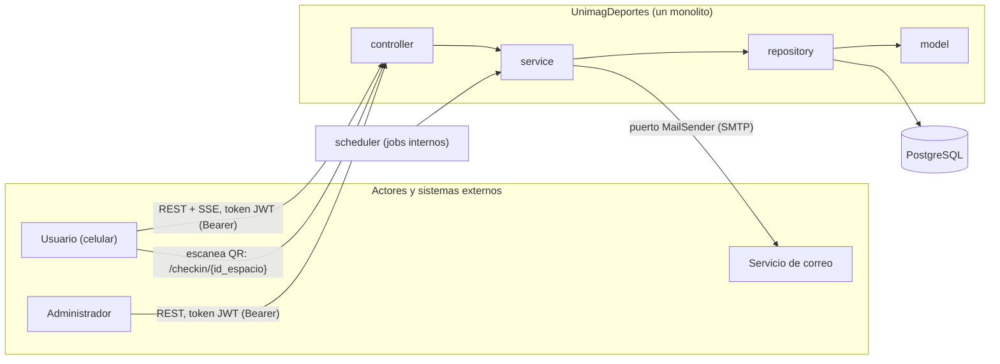
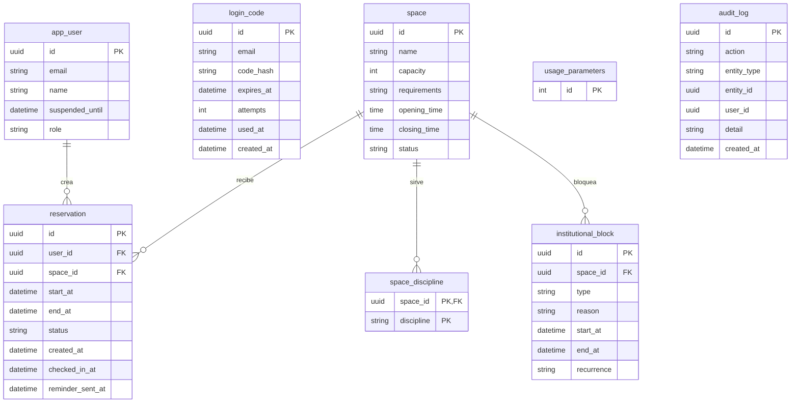
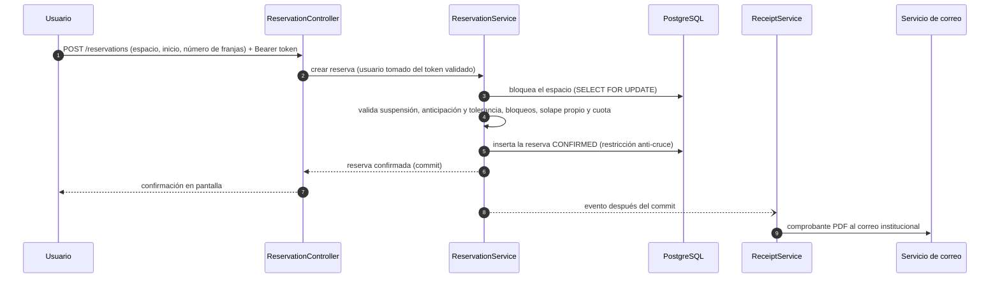
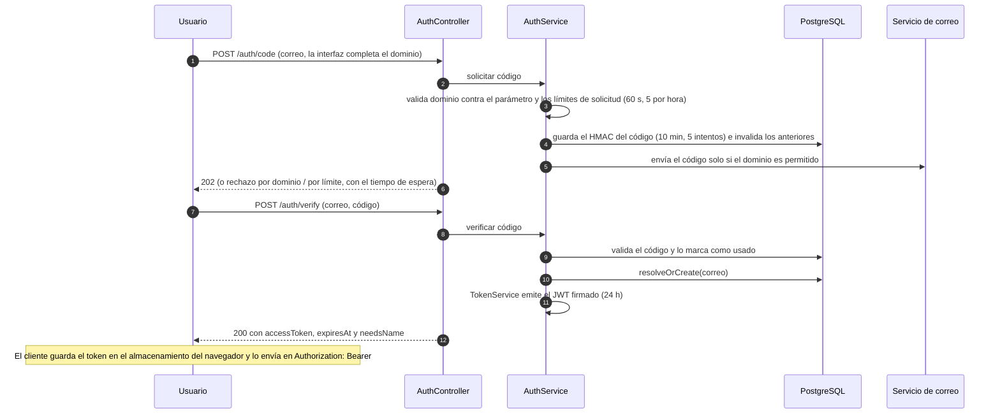
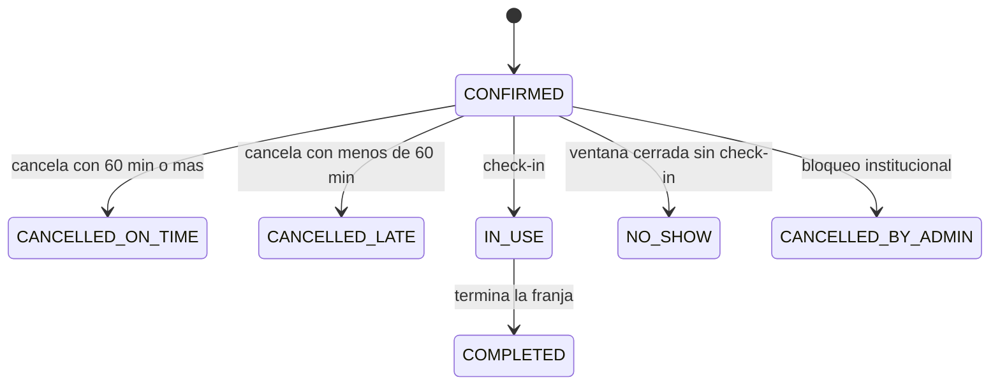

# Implementation Plan: UnimagDeportes — Plataforma de reserva de canchas

**Date**: 2026-10-13
**Última revisión**: 2026-10-14 (login con código de un solo uso y token JWT de 24 horas sin cookies, alineado con `unimagDeportes.md` §5.11 y las SPEC 001 y 011)
**Spec**: `docs/features/001-…` a `docs/features/012-…` (UC01–UC12). **Fuente funcional**: `docs/reglas-y-contexto/unimagDeportes.md`. Si un SPEC y el contexto discrepan, se consulta antes de decidir.
**Alcance de este documento**: solo la estructura general. Clases concretas, SQL exacto y contratos detallados van en `docs/features/<NNN>-<nombre>/plan.md` (ver §11).
**Leyenda**: **[CONTEXTO]** respaldado por `unimagDeportes.md` o los SPEC · **[TÉC]** propuesta técnica por confirmar · **OQ-xx** punto abierto (§10) · **H1/H2/H3** historia de usuario 1, 2 o 3 dentro de un SPEC.

---

## Summary

UnimagDeportes es una aplicación web para reservar canchas de la universidad (baloncesto, voleibol, fútbol 5, fútbol 11 y tenis de campo) con disponibilidad en tiempo real, confirmación automática y reglas de uso aplicadas sin intervención del administrador. No hay cobros: el único control es la cuota semanal.

Se construye como **un monolito (un solo despliegue) con arquitectura de n capas**: `controller → service → repository → model`, con **PostgreSQL**. No hay colas de mensajería ni microservicios; el único sistema externo es el **servicio de correo**.

El acceso se hace con el **correo institucional y un código de un solo uso enviado a ese correo** (sin contraseñas). Al validar el código, el sistema entrega un **token JWT con vigencia de 24 horas, sin cookies ni renovación automática** (RN-49 a RN-56). Es un prototipo 100 % funcional pensado para ser **sustituido por el inicio de sesión de Microsoft** de la universidad sin tocar los casos de uso de negocio (§7.1.5, D-08, D-09).

---

## Technical Context

**Language/Version**: Java (LTS vigente) **[TÉC, OQ-01]**. El `pom.xml` actual usa Java 25.
**Primary Dependencies**: Spring Boot (estable vigente; el `pom.xml` actual usa 4.1.1): Web MVC (en Boot 4, `spring-boot-starter-webmvc`), Validation, Data JPA, Security (API sin estado: filtro propio de JWT, sin cookies ni Spring Session), Mail, Scheduling, Actuator, Flyway. Librería JWT (por ejemplo, Nimbus JOSE+JWT, incluida en `spring-security-oauth2-jose`) **[TÉC, OQ-01]**. Librería de PDF a elegir en el plan de UC11.
**Storage**: PostgreSQL (`timestamptz`; extensión `btree_gist` para impedir cruces)
**Testing**: JUnit 5, AssertJ, Mockito, Testcontainers (PostgreSQL), servidor de correo de prueba (por ejemplo GreenMail). En desarrollo local, Mailpit para ver los correos reales que genera la aplicación.
**Target Platform**: Contenedores Docker; Docker Compose en desarrollo (PostgreSQL y Mailpit)
**Project Type**: Backend monolítico (API REST + SSE). El cliente web *mobile-first* lo consume y envía el token en el encabezado `Authorization: Bearer` (RN-55). Como no hay cookies, no se exige que cliente y API compartan el mismo sitio; si están en orígenes distintos, se configura CORS (sin credenciales) (OQ-13).
**Constraints** **[CONTEXTO]**: cero cruces con verificación y bloqueo transaccional (RN-10); parámetros configurables, no fijos en el código (sección 4); fechas en America/Bogota (RNF-07); solo nombre y correo del usuario (RNF-09); auditoría de reservas, cancelaciones, check-ins, sanciones e inicios y cierres de sesión (RNF-08); reservar en 5 pasos o menos y en 40 s con sesión ya iniciada (RNF-01, RNF-03); *mobile-first* y WCAG (RNF-02, RNF-05); seguridad de la sesión: HTTPS, llave de firma fuera del código, algoritmo fijado por el servidor y medidas contra XSS (RNF-10)
**Scale/Scope**: 12 SPECs (UC01–UC12) con 22 historias de usuario; actores Usuario, Administrador, Servicio de correo y Sistema. Una sola universidad y volumen bajo: una instancia basta.

---

## 1. Alcance y trazabilidad SPEC → componentes

Cada SPEC agrupa los casos de uso del diagrama que comparten actor, datos y reglas; el contenido de cada caso quedó como una historia de usuario dentro de su SPEC (D-16).

| UC (SPEC) | Historias de usuario | Quién lo invoca | Canal |
|---|---|---|---|
| UC01 Iniciar sesión | H1 Acceder con correo institucional y código de acceso · H2 Mantener, expirar y cerrar la sesión | Usuario, Administrador | REST (token JWT en `Authorization: Bearer`) |
| UC02 Consultar disponibilidad | H1 Calendario en tiempo real | Usuario, Administrador; interno (`include` de UC03) | REST + SSE |
| UC03 Reservar espacio deportivo | H1 Reservar una o dos franjas | Usuario | REST |
| UC04 Gestionar mis reservas | H1 Consultar · H2 Cancelar | Usuario | REST |
| UC05 Confirmar asistencia (QR) | H1 Check-in · H2 Generar e imprimir QR | Usuario · Administrador | REST (enlace del QR) |
| UC06 Reglas de uso | H1 Consultar · H2 Configurar | Usuario · Administrador | REST |
| UC07 Gestionar espacios y franjas | H1 Espacios y horario · H2 Bloquear franjas | Administrador | REST |
| UC08 Consultar cuota semanal | H1 Ver cuota · H2 Reinicio semanal | Usuario · Sistema | REST (H1); derivado (H2, ver D-06) |
| UC09 Consultar panel de administración | H1 Ocupación · H2 Indicadores | Administrador | REST |
| UC10 Aplicar sanciones | H1 Inasistencia · H2 Suspensión | Sistema | Scheduler |
| UC11 Enviar correos al usuario | H1 Comprobante PDF · H2 Notificaciones · H3 Código de acceso | Interno (H1 es `include` de UC03; H3 lo invoca UC01) · Sistema | Servicio de correo |
| UC12 Contactar administrador | H1 Enviar mensaje | Usuario | REST |

**Relaciones del diagrama UML respetadas** (`docs/uc-diagrams/Unimag-deportes-uc-diagram`): `include`: UC03→UC02 y UC03→UC11-H1 (comprobante). Los 11 casos del diagrama quedan cubiertos: Iniciar sesión (UC01), Consultar disponibilidad (UC02), Reservar espacio (UC03), Consultar mis reservas y Cancelar reserva (UC04), Confirmar asistencia (UC05-H1), Consultar y Configurar reglas (UC06), Gestionar espacios y Bloquear franjas (UC07), Enviar comprobante (UC11-H1). Provienen del contexto y aún no están en el diagrama: UC01-H2, UC05-H2, UC08, UC09, UC10, UC11-H2, UC11-H3 y UC12. La invocación de UC11-H3 desde UC01 es una relación interna, no un `include` del diagrama.

---

## 2. Principios rectores

1. **Cero cruces**: un espacio nunca tiene dos reservas activas en la misma franja. La verificación y el bloqueo ocurren en una sola transacción, respaldada por una restricción en la base de datos (RN-10).
2. **Reglas configurables**: los parámetros de la sección 4 viven en la base de datos, nunca en el código.
3. **Las mismas reglas para todos** los Usuarios (RN-02); no hay cobros monetarios (principio 1).
4. **La identidad sale siempre del token validado**, nunca del cuerpo, la URL ni el QR (RN-03, RN-32).
5. **Datos mínimos del Usuario**: nombre y correo institucional (RNF-09).
6. **Toda fecha y hora en America/Bogota**, con un `Clock` inyectado (RNF-07).
7. **La cuota se deriva de las reservas**, no se almacena (RN-16, RN-17, RN-19).
8. **Un fallo de correo no deshace una operación de negocio** **[TÉC, OQ-04]**. Excepción: el código de acceso. Sin correo no hay ingreso, así que se informa al Usuario y se le deja reintentar.
9. **Los estados de la reserva son los de la sección 6 del contexto** y solo cambian a través de los services.
10. **El mecanismo de autenticación es sustituible**: fuera de `security` y del módulo `auth`, nadie sabe cómo se autenticó la persona. El resto del sistema solo ve un `UserPrincipal(id, email, role)` (D-08, D-09).
11. **El token no congela permisos**: el rol y el estado del Usuario se leen de la base de datos en cada petición (RN-58), el token tiene una vigencia fija de 24 horas sin renovación (RN-54, RN-56) y no se guarda en cookies (RN-55) (D-17 a D-19).

---

## 3. Arquitectura

### 3.1 Vista de contexto



### 3.2 Decisión de capas: n capas simples en un solo módulo

| Capa | Paquete | Responsabilidad |
|---|---|---|
| Controller | `controller` | Entrada HTTP (REST y SSE): valida el formato, mapea DTO y exige el rol. Sin lógica de negocio. |
| Service | `service` | Casos de uso y reglas de negocio; define las transacciones. Las reglas puras viven en `service/policy`. |
| Repository | `repository` | Acceso a datos (Spring Data JPA; consultas nativas donde haga falta). |
| Model | `model` | Entidades JPA y enumeraciones. |

Paquetes transversales: `dto`, `security`, `mail`, `scheduler`, `exception`, `config`.

Dentro de cada capa los archivos se agrupan por **módulo de negocio** (`auth`, `space`, `reservation`, `block`, `parameter`, `notification`, `report`). Los módulos se hablan **solo mediante sus services**, de modo que si algún día hay que separar uno, la frontera ya existe.

| Concepto compartido | SPEC que lo tocan |
|---|---|
| `Reservation` (estado, horario, check-in) | UC03 la crea; UC04 la lista (H1) y la cancela (H2); UC05-H1 registra el check-in; UC07-H2 la cancela por bloqueo; UC10 la marca inasistencia o completada; UC08, UC09 y UC02 la leen |
| `UsageParameters` | UC06-H2 la escribe; UC01, UC03, UC04, UC05, UC06-H1, UC08, UC10 y UC11 la leen |
| `Space` (y sus franjas derivadas) | UC07-H1 lo escribe; UC02, UC03, UC05-H2 (QR) y UC09 lo leen |
| `InstitutionalBlock` | UC07-H2 lo crea; UC02, UC03 y UC09 lo leen |
| `AppUser` (incluye suspensión y rol) | UC01 lo crea; UC10-H2 lo suspende; UC03 valida su estado; el filtro de `security` lo lee en cada petición |
| `LoginCode` | UC01-H1 lo crea y lo valida; `AuthCleanupJob` borra los vencidos |
| `MailSender` (correo saliente) | UC01 (código de acceso, UC11-H3), UC11 (comprobante y notificaciones) y UC12 |

### 3.3 Estructura del proyecto

```text
unimag-deportes/
├── docs/
│   ├── technical-plan/general-plan.md          # Este documento
│   ├── reglas-y-contexto/unimagDeportes.md
│   ├── uc-diagrams/
│   └── features/NNN-<uc>/{spec.md, plan.md}
├── src/main/java/com/unimag/deportes/          # paquete raíz por confirmar (OQ-01)
│   ├── UnimagDeportesApplication.java
│   ├── controller/       # auth, availability, reservation, checkin, space, block, parameter, quota, report, contact
│   ├── service/          # un service por tema
│   │   └── policy/       # QuotaPolicy, CancellationPolicy, CheckInWindowPolicy, BookingWindowPolicy, WeekCalculator,
│   │                     # LoginCodePolicy
│   ├── repository/       # un repositorio por entidad
│   ├── model/            # AppUser, LoginCode, Space, Reservation, InstitutionalBlock,
│   │                     # UsageParameters, AuditLog + enums (ReservationStatus, Discipline, BlockType, Role)
│   ├── dto/              # request/response (las entidades no se exponen)
│   ├── security/         # JwtAuthenticationFilter, UserPrincipal, SecurityConfig (API sin estado, sin cookies ni CSRF),
│   │                     # control de roles, límite de solicitudes de código y de intentos
│   ├── mail/             # MailSender (puerto), SmtpMailSender, plantillas, ReceiptPdfGenerator
│   ├── scheduler/        # ReservationLifecycleJob, ReminderJob, AuthCleanupJob
│   ├── exception/        # BusinessException y derivadas + GlobalExceptionHandler
│   └── config/           # Spring, Clock (America/Bogota), seguridad, SSE
├── src/main/resources/{application.properties, db/migration/V*.sql}
├── src/test/java/…       # espejo de paquetes
├── Dockerfile
├── compose.yaml          # PostgreSQL y Mailpit (desarrollo)
└── pom.xml
```

### 3.4 Reglas de dependencia

1. `controller` solo invoca `service` y usa `dto`; nunca `repository` ni `model`.
2. `service` usa `repository`, `model` y otros `service`. **No usa el repository de otro módulo**: pide al service de ese módulo.
3. `repository` solo conoce `model`.
4. Las entidades JPA no salen del service: los controllers reciben y devuelven DTO.
5. `service/policy` es **puro** (sin Spring ni JPA): recibe valores y devuelve decisiones, y se prueba con pruebas unitarias.
6. Controller, filtro de seguridad y scheduler son puntos de entrada: todos llaman a services.
7. Ningún componente lee la hora del sistema: todos usan el `Clock` inyectado.
8. Opcional: verificar las reglas 1 a 4 y la 9 con ArchUnit en las pruebas.
9. **Aislamiento de la autenticación**: solo `security` y los services del módulo `auth` (`AuthService`, `LoginCodeService`, `TokenService`, `UserService`) conocen cómo se autenticó la persona. Los demás controllers y services reciben un `UserPrincipal` y nunca tocan códigos ni tokens.

### 3.5 Mapa SPEC → componentes (semilla de los planes específicos)

| UC | Controller / entrada | Services principales | Persistencia | Invariantes clave |
|---|---|---|---|---|
| UC01 | `AuthController` (incluye `/me`) | `AuthService`, `LoginCodeService`, `TokenService` (emite y verifica el JWT), `UserService` (`resolveOrCreate(email, name)`) | `app_user`, `login_code`, `audit_log` | **H1**: dominio institucional (parámetro) validado en el servidor sobre el correo completo (RN-50); código de 6 dígitos guardado como HMAC, de un solo uso, con 10 min de vigencia y 5 intentos (RN-51, RN-52); mínimo 60 s entre solicitudes y máximo 5 por hora por correo, informando la espera (RN-53), más un límite por IP; un código nuevo invalida el anterior; usuario nuevo creado al primer ingreso y nombre pedido una sola vez (sin nombre solo se permiten `/me` y `/auth/*`) (RN-59); el Usuario suspendido puede iniciar sesión (RN-05); rol de Administrador solo para correos configurados (RN-60). **H2**: JWT firmado de 24 h con id, correo, rol, emisión y expiración, sin cookies ni renovación (RN-54 a RN-56); el filtro valida firma, algoritmo y vigencia y lee el estado actual del Usuario en la base de datos (RN-58); cierre de sesión borra el token del dispositivo y queda auditado; varias sesiones a la vez (RN-57); `returnTo` solo acepta rutas internas. Detalle en §7.1 |
| UC02 | `AvailabilityController` | `AvailabilityService` | lectura de `space`, `reservation`, `institutional_block` | Franja libre, ocupada o bloqueada; el espacio compartido se ocupa completo (RN-07); mantenimiento no reservable (RN-09); franja iniciada reservable hasta fin de tolerancia (RN-27, RN-28); motivo visible en bloqueos (RN-44); cambios por SSE con el token en el encabezado (OQ-17); consulta sin sesión: OQ-14 |
| UC03 | `ReservationController` | `ReservationService`, `QuotaService` | `reservation` | Una transacción: bloquear espacio → validar → insertar; 1 o 2 franjas consecutivas; hasta 7 días (ver OQ-12); sin solape propio (RN-11); cuota (4 h por defecto, configurable); no suspendido; comprobante después del commit (UC11-H1) |
| UC04 | `ReservationController` | H1 `ReservationQueryService` · H2 `CancellationService`, `CancellationPolicy` | `reservation` | H1: solo las reservas del Usuario del token, todos los estados, acción de cancelar. H2: vista previa con efecto en la cuota (RN-25); 60 min o más = a tiempo, menos = tardía (umbral configurable); no se cancela con check-in (RN-24); notifica (RN-26); no hay cancelación manual del Administrador |
| UC05 | `CheckInController` · `SpaceController` (QR, admin) | H1 `CheckInService`, `CheckInWindowPolicy` · H2 `QrService` | `reservation` (H1); H2 se deriva del id del espacio | H1: el Usuario del token debe ser el dueño de la reserva en ese espacio (RN-33); sin token vigente, el cliente lleva al login y vuelve a `/checkin/{id_espacio}`; si el QR se abre en otro navegador hay que iniciar sesión de nuevo (RN-34); ventana desde 10 min antes hasta fin de tolerancia; reservas hechas en tolerancia: 10 min desde su creación (RN-30); motivo de rechazo visible (RN-35). H2: QR estático con enlace fijo `/checkin/{id_espacio}`, sin datos del Usuario (RN-31, RN-32); imprimible |
| UC06 | `ParameterController` (H1 público, H2 admin) | `ParameterService` | `usage_parameters` | H1: lenguaje claro, valores vigentes, sin números fijos en el código. H2: solo Administrador; edita los parámetros de la sección 4 (sin cobros); efecto sobre reservas existentes: OQ-05; parámetros de acceso: OQ-19 |
| UC07 | `SpaceController` (H1, admin) · `BlockController` (H2, admin) | H1 `SpaceService` · H2 `BlockService` | `space`, `space_discipline`, `institutional_block`, `reservation` | H1: atributos de RN-06; franjas de 60 min derivadas del horario de operación (RN-08); mantenimiento no reservable. H2: prioridad sobre reservas libres (RN-42); cancela las afectadas con estado `CANCELLED_BY_ADMIN`, no cuentan cuota y avisa con motivo (RN-43); bloquea el espacio durante la operación; confirmación adicional del Administrador: OQ-16 |
| UC08 | `QuotaController` | `QuotaService`, `WeekCalculator` | lectura de `reservation` | H1: horas usadas = reservas que cuentan en la semana (lunes 00:00 America/Bogota); disponibles = cuota − usadas; fecha de reinicio = próximo lunes. H2: sin job; la cuota se calcula sobre la semana de la fecha de la franja (RN-17) |
| UC09 | `ReportController` (admin) | H1 `OccupancyService` · H2 `IndicatorService` | consultas sobre `reservation`, `institutional_block`, `space`, `app_user` | Solo lectura; H1 con filtros por fecha, disciplina y espacio; H2: reservas, cancelaciones tardías, inasistencias y suspendidos, período: OQ-08 |
| UC10 | `ReservationLifecycleJob` | `SanctionService` | `reservation`, `app_user` | Sin check-in al cerrar la ventana → `NO_SHOW` con horas contadas; 3 en 30 días → suspende 7 días; reservas futuras se mantienen (RN-37 a RN-40); conteo tras suspensión: OQ-07 |
| UC11 | llamadas internas · `ReminderJob` | H1 `ReceiptService` · H2 `NotificationService` + `MailSender` · H3 envío del código de acceso (`LoginCodeService` → `MailSender`) | `reservation.reminder_sent_at` | H1: PDF con espacio, fecha, hora, nombre, reglas de cancelación y canal de contacto (RN-45, RN-48), al correo del Usuario. H2: recordatorio 2 h antes con enlace para cancelar (RN-46); cancelación, bloqueo, inasistencia y suspensión (RN-47); todos con canal de contacto (RN-48); falla de entrega: OQ-04. H3: el correo lleva el código, su vigencia y la advertencia de no compartirlo, más el canal de contacto; llega en menos de 1 minuto (RNF-11); solo a dominios permitidos (RN-50); nunca se registra el código en claro |
| UC12 | `ContactController` | `ContactService` + `MailSender` | — | Envía el mensaje al correo del área de deportes; sin persistir (OQ-10) |

---

## 4.1 Modelo de datos (PostgreSQL)

Convenciones: UUID como identificadores, `timestamptz` para instantes (se interpretan en America/Bogota), enums como texto, migraciones versionadas con Flyway. **No hay tabla de franjas, de cuota ni de sesiones**: la cuota y las franjas se derivan (D-06) y la sesión vive en el token (D-17).

| Tabla | Propósito / columnas relevantes | Restricciones |
|---|---|---|
| `app_user` | `id`, `email`, `name` (vacío hasta el primer ingreso), `suspended_until`, `role` **[TÉC, OQ-02]**, `created_at` | `UNIQUE(email)` guardado en minúsculas y sin espacios; solo nombre y correo como datos personales (RNF-09) |
| `login_code` | `id`, `email`, `code_hash` (HMAC con clave del servidor), `expires_at`, `attempts`, `used_at`, `created_at` | Un solo uso; al pedir un código nuevo se invalidan los anteriores del correo; las solicitudes por correo se cuentan con `created_at` (mínimo 60 s entre solicitudes y máximo 5 por hora, RN-53); `AuthCleanupJob` borra los vencidos |
| `space` | `id`, `name`, `capacity`, `requirements`, `opening_time`, `closing_time` **[TÉC, OQ-06]**, `status` (`ACTIVE`, `MAINTENANCE`) | RN-06 |
| `space_discipline` | `space_id`, `discipline` (baloncesto, voleibol, fútbol 5, fútbol 11, tenis de campo) | `PRIMARY KEY(space_id, discipline)` |
| `reservation` | `id`, `user_id`, `space_id`, `start_at`, `end_at`, `status`, `created_at`, `checked_in_at`, `reminder_sent_at` | `CHECK(end_at > start_at)`; **restricción de exclusión**: mismo `space_id` con rangos que se solapan solo entre estados que no liberan el espacio; **segunda exclusión** equivalente por `user_id` (RN-11) |
| `institutional_block` | `id`, `space_id`, `type` (clases y grupos formativos, eventos o torneos, mantenimiento), `reason`, `start_at`, `end_at`, `recurrence` (nullable, OQ-06) | Índice por `(space_id, start_at)` |
| `usage_parameters` | Singleton (`id = 1`): una columna por cada parámetro de la sección 4 | `CHECK` de rangos; cada guardado sobrescribe |
| `audit_log` | `id`, `action`, `entity_type`, `entity_id`, `user_id` (nullable), `detail`, `created_at` | RNF-08; sin códigos ni tokens en `detail`. Además de reservas, cancelaciones, check-ins y sanciones, registra `CODE_REQUESTED`, `LOGIN`, `LOGIN_FAILED` y `LOGOUT` (RN-61) |

**Estados de la reserva que no liberan el espacio** (participan en la restricción de exclusión): `CONFIRMED`, `IN_USE`, `COMPLETED`, `NO_SHOW`. Las tres cancelaciones liberan.

**Por qué dos mecanismos para no cruzar** (D-04, D-05): la restricción de exclusión impide dos reservas solapadas en la tabla `reservation`. Como los bloqueos viven en otra tabla, además se bloquea la fila del espacio durante las operaciones de reservar y bloquear.

### 4.2 Diagrama Entidad-Relación



`login_code` no se relaciona por clave foránea con `app_user`: el código se pide antes de que la cuenta exista (la cuenta se crea al verificar el primer código, RN-59). No hay tabla de sesiones: el JWT es autocontenido y el estado del Usuario se lee de `app_user` en cada petición (RN-58).

---

## 5. Conexiones y procesos internos

### 5.1 Matriz de conexiones

| # | Origen → Destino | UC | Estilo | Transporte |
|---|---|---|---|---|
| C1 | Usuario o Administrador → sistema | UC01 a UC09, UC12 | Request/response | REST con token JWT (`Authorization: Bearer`) |
| C2 | Usuario o Administrador → sistema | UC02 | Actualización en vivo | SSE (el token viaja por encabezado; ver §5.3 y OQ-17) |
| C3 | Usuario → sistema | UC05-H1 | Enlace fijo del QR | `/checkin/{id_espacio}` (ruta del cliente) que llama al endpoint de check-in; sin token vigente, el cliente lleva al login con `returnTo` y regresa |
| C4 | Sistema → Servicio de correo | UC01 (código, UC11-H3), UC11, UC12 | Envío | SMTP mediante el puerto `MailSender` |
| C5 | Sistema → sistema | UC10, UC11-H2, limpieza de UC01 | Eventos por tiempo | Scheduler |

El sistema **no usa colas de mensajería**: los correos se envían después del commit mediante un evento interno. El código de acceso es la excepción: se envía dentro de la solicitud, porque el Usuario espera el correo para continuar y debe saber si falló.

### 5.2 Jobs internos programados

| Job | Origen | Regla |
|---|---|---|
| `ReservationLifecycleJob` (cada minuto) | UC10 y sección 6 del contexto | (a) Reservas `CONFIRMED` sin check-in cuya ventana cerró pasan a `NO_SHOW`, se evalúa la suspensión y se notifica. (b) Reservas `IN_USE` cuya franja terminó pasan a `COMPLETED`. |
| `ReminderJob` (cada minuto) | UC11-H2 | Reservas `CONFIRMED` que empiezan en 2 horas o menos y con `reminder_sent_at IS NULL`: envía el recordatorio y marca la fecha. |
| `AuthCleanupJob` (cada hora) | UC01 | Borra los códigos de acceso vencidos o usados **[TÉC]**. No hay sesiones que limpiar. |

Los tres jobs son idempotentes (se apoyan en el estado y en `reminder_sent_at`). **El reinicio semanal (UC08-H2) no tiene job**: ver D-06. Con una sola instancia no hace falta bloqueo de jobs; si algún día se despliegan varias, habrá que agregarlo.

### 5.3 Calendario en vivo

`GET /spaces/{id}/availability/stream` (SSE) avisa al cliente cuando cambia la disponibilidad del espacio (reserva, cancelación, bloqueo, cambio de estado). El cliente vuelve a pedir el calendario.

**Autenticación del SSE** **[TÉC, OQ-17]**: el `EventSource` nativo del navegador no permite enviar el encabezado `Authorization`. El cliente debe abrir el flujo con `fetch` (o una librería de SSE basada en `fetch`) y enviar el token en el encabezado. **El token nunca va en la URL**, porque quedaría en los registros del servidor y del proxy. Alternativa si esto complica el cliente: *polling* corto (D-11).

### 5.4 Flujo de referencia: reservar → comprobante



### 5.5 Flujo de referencia: iniciar sesión con código



Si la persona escaneó un QR sin token vigente (RN-34), el cliente guarda `/checkin/{id_espacio}` como `returnTo`, hace este flujo y vuelve al check-in. Igual ocurre cuando el token expira a las 24 horas: el cliente guarda la pantalla actual, pide un código nuevo y regresa (RN-56).

---

## 6. Contratos (índice de endpoints) **[TÉC]**

Este índice solo fija las rutas y los roles. El detalle de cada contrato (solicitud, respuesta y errores) se escribe en el `plan.md` de cada SPEC. Salvo los públicos, todos los endpoints exigen `Authorization: Bearer <token>`.

| Método y ruta | UC | Rol |
|---|---|---|
| `POST /auth/code` | UC01-H1 | Público (con límite de solicitudes) |
| `POST /auth/verify` | UC01-H1 | Público (con límite de intentos) |
| `GET /me` | UC01 | Autenticado |
| `PUT /me/profile` (nombre en el primer ingreso) | UC01-H1 | Autenticado |
| `POST /auth/logout` (registra la auditoría; el cliente elimina el token) | UC01-H2 | Autenticado |
| `GET /spaces?discipline=` | UC02, UC03 | Usuario, Administrador |
| `GET /spaces/{id}/availability?date=` | UC02 | Usuario, Administrador |
| `GET /spaces/{id}/availability/stream` (SSE) | UC02 | Usuario, Administrador |
| `POST /reservations` | UC03 | Usuario |
| `GET /reservations/mine` | UC04-H1 | Usuario |
| `GET /reservations/{id}/cancellation-preview` | UC04-H2 | Usuario |
| `POST /reservations/{id}/cancellation` | UC04-H2 | Usuario |
| `POST /checkin/{spaceId}` | UC05-H1 | Usuario |
| `GET /admin/spaces/{id}/qr` | UC05-H2 | Administrador |
| `GET /rules` | UC06-H1 | Usuario |
| `GET /admin/parameters`, `PUT /admin/parameters` | UC06-H2 | Administrador |
| `GET/POST/PUT /admin/spaces` | UC07-H1 | Administrador |
| `POST /admin/blocks` | UC07-H2 | Administrador |
| `GET /quota/me` | UC08-H1 | Usuario |
| `GET /admin/occupancy` | UC09-H1 | Administrador |
| `GET /admin/indicators` | UC09-H2 | Administrador |
| `POST /contact` | UC12 | Usuario |

Sin endpoint propio: UC08-H2, UC10 y UC11 (internos; UC11-H3 lo dispara `POST /auth/code`).

Con Microsoft (§7.1.5), `/auth/code` y `/auth/verify` se reemplazan por el flujo OAuth (`/oauth2/authorization/microsoft` y su retorno). `/me`, `/auth/logout` y todos los endpoints de negocio no cambian, porque el cliente sigue recibiendo el mismo JWT.

---

## 7. Aspectos transversales

### 7.1 Seguridad

#### 7.1.1 Login por código al correo institucional **[CONTEXTO: RN-49 a RN-53; valores marcados «propuesto» por confirmar, OQ-03]**

**Flujo**
1. El Usuario escribe solo su usuario (`jperez`) y la interfaz completa el dominio. **El servidor valida el correo completo** (un solo `@`, dominio exacto contra el parámetro de UC06-H2) y no confía en lo que hizo la interfaz (RN-50).
2. Se verifican los límites de solicitud: mínimo 60 segundos desde la solicitud anterior y máximo 5 por hora por correo; si se superan, se rechaza e informa cuánto esperar (RN-53). Si el dominio es permitido y se cumplen los límites, se genera un código de 6 dígitos con un generador seguro, se guarda su HMAC, se invalidan los códigos anteriores del correo y se envía por correo (UC11-H3). Si el dominio no es permitido, se rechaza y no se envía nada.
3. El Usuario escribe el código (campo con `autocomplete="one-time-code"` para que el celular lo sugiera). Se valida que esté vigente, sin usar y con menos de 5 intentos fallidos, y se marca como usado (RN-51, RN-52).
4. `UserService.resolveOrCreate(email, name)` ubica o crea el `app_user` y `TokenService` emite el JWT, que se devuelve en el cuerpo de la respuesta. El cliente lo guarda y vuelve a su `returnTo`.

**Por qué código y no enlace mágico**: el flujo del QR (RN-34) empieza en el celular, y el enlace de un correo suele abrirse en otro navegador o en un WebView, donde se pierden el token y el destino. Con código, todo ocurre en la misma pestaña.

**Primer ingreso**: el código no trae el nombre y el comprobante lo necesita (RN-45). Se pide una sola vez (`PUT /me/profile`); mientras falte, el filtro solo deja pasar `/me` y `/auth/*`, y los demás endpoints responden `403 PROFILE_INCOMPLETE` (RN-59). Con Microsoft el nombre vendrá en el token y este paso desaparece.

| Regla del código | Valor |
|---|---|
| Formato | 6 dígitos, generador criptográficamente seguro (RN-51) |
| Almacenamiento | HMAC con clave del servidor; nunca el código en claro (un hash simple de 6 dígitos se rompe por fuerza bruta si la tabla se filtra) (RN-51, RNF-09) |
| Vigencia | 10 minutos (RN-51) |
| Uso | Un solo uso; pedir uno nuevo invalida los anteriores del correo (RN-51) |
| Intentos de verificación | 5 por código; al superarlos el código se invalida (RN-52) |
| Solicitudes | Mínimo 60 s entre solicitudes y máximo 5 por hora por correo (RN-53), y un límite por IP **[TÉC]** para impedir que se use la plataforma para llenar buzones ajenos |
| Respuesta | El rechazo por dominio es explícito (el dominio no es secreto); el rechazo por límite informa el tiempo de espera |
| Correo enviado | Solo a dominios permitidos; indica la vigencia y que el código no se comparte con nadie; incluye el canal de contacto (RN-48, RNF-11) |

Con 5 solicitudes por hora y 5 intentos por código, un atacante tiene como máximo 25 intentos por hora sobre 1.000.000 de combinaciones: 0,0025 % por hora y por correo. El bloqueo temporal tras fallos acumulados se define en el plan de UC01.

#### 7.1.2 Token de sesión (JWT) **[CONTEXTO: RN-54 a RN-58, RNF-10]**

**Mecanismo.** Al verificar el código, el servidor emite un JWT firmado con los datos mínimos que exige RN-54: `sub` (id del Usuario), `email`, `role`, `iat` y `exp` (`iat` + 24 horas). La firma usa un secreto de al menos 256 bits (HMAC-SHA256) **[TÉC]**; si algún día otro servicio debe verificar tokens, se pasa a firma asimétrica. El servidor **fija el algoritmo**: rechaza `alg: none` y cualquier algoritmo distinto, sin aceptarlo del cliente (RNF-10). La llave vive fuera del repositorio.

**Entrega y almacenamiento.** El token viaja en el cuerpo de la respuesta de `/auth/verify`; **no se usa `Set-Cookie`** (RN-55). El cliente lo conserva en el almacenamiento del navegador y lo envía en `Authorization: Bearer` en cada petición. Se usa `localStorage` **[TÉC]** porque `sessionStorage` es por pestaña y el QR abre una pestaña nueva, donde se perdería la sesión. Al no haber cookies, no aplica CSRF.

**Vigencia.** 24 horas desde la emisión para todos los roles, sin renovación automática ni *refresh token* (RN-54, RN-56). Si el filtro encuentra el token vencido, responde `401 TOKEN_EXPIRED`; el cliente guarda la pantalla actual, lleva al login y regresa al terminar (RN-56). El Administrador usa el mismo mecanismo (sección 2 del contexto); un token más corto para el Administrador queda como OQ-16.

**Cierre y varios dispositivos.** `POST /auth/logout` registra el cierre en la auditoría (RN-61) y el cliente elimina el token del dispositivo. Cada dispositivo tiene su propio token, de modo que cerrar uno no afecta a los demás (RN-57). **El token no se revoca en el servidor**: uno copiado seguiría siendo válido hasta su `exp`. Lo mitigan RN-58 (suspensión, cambio de rol o eliminación del Usuario aplican de inmediato), la vigencia de 24 horas y las medidas contra XSS. Si se necesitara revocación, una opción barata es `app_user.tokens_valid_after`, comparada con `iat` en el filtro (una sola sentencia `UPDATE` invalida todos los tokens de una persona) (OQ-18).

**Rotación de la llave.** Cambiar el secreto invalida todos los tokens a la vez; con una vigencia de 24 horas el costo es que todos pidan un código nuevo.

#### 7.1.3 Amenazas y mitigaciones

| Amenaza | Mitigación |
|---|---|
| Robo del token por XSS (el token está en el almacenamiento del navegador y es legible por JavaScript) | Es el riesgo principal de este diseño. CSP estricta, escape de todos los datos mostrados, sin scripts de terceros, dependencias del cliente mínimas y fijadas, vigencia de 24 horas (RNF-10) |
| Robo en la red | HTTPS obligatorio, HSTS |
| CSRF | No aplica: no hay cookies y el token va en un encabezado que el navegador no agrega solo. CSRF de Spring Security desactivado en la API sin estado |
| Token forjado por fuga de la llave de firma | Llave en variable de entorno o gestor de secretos, nunca en el repositorio ni en la base de datos; rotación ante sospecha |
| Algoritmo manipulado (`alg: none`, confusión de algoritmos) | El servidor fija el algoritmo y rechaza el resto (RNF-10) |
| Token alterado | Verificación de firma en cada petición; el usuario del `sub` debe existir en la base de datos |
| Fuga de la base de datos | Solo se guarda el HMAC del código; no hay tokens en la base: quien lea las tablas no puede suplantar a nadie ni adivinar códigos |
| Fuerza bruta del código | 5 intentos, 10 minutos, 5 solicitudes por hora (§7.1.1) |
| Llenar buzones ajenos con códigos | 60 s mínimos entre solicitudes, 5 por hora por correo, límite por IP; no se envía a dominios no permitidos |
| Redirección abierta (`returnTo`) | Solo se aceptan rutas internas que empiezan con `/` (no `//`); el cliente valida contra sus rutas conocidas |
| Inyección en cabeceras del correo | El correo se valida estrictamente y nunca se arma una cabecera con texto crudo del cliente |
| Equipo perdido o compartido | El cierre de sesión borra el token del dispositivo; sin revocación en el servidor el token vive hasta 24 horas (OQ-18) |
| Token robado y usado | Vigencia máxima de 24 horas sin renovación; suspensión y cambio de rol aplican de inmediato (RN-58) |
| Phishing del código | No se evita con OTP: el correo advierte que no se comparte. Microsoft con MFA lo reduce (§7.1.7) |
| Correo del Usuario comprometido | Quien controla el buzón controla la cuenta, igual que con SSO; se mitiga con la vigencia de 24 horas |

#### 7.1.4 Autorización: el token no congela los permisos

- `JwtAuthenticationFilter` verifica con `TokenService` la firma, el algoritmo y la vigencia del token y toma el `sub`. Luego hace **una sola consulta** a `app_user` y comprueba que el Usuario exista (RN-58).
- El `UserPrincipal(id, email, role)` se arma con los datos **actuales** de `app_user`, no con lo que dice el token. El `role` del token es informativo: si el rol cambia, el efecto es inmediato.
- Un Usuario suspendido conserva su token y puede consultar (RN-05); lo que se rechaza es crear reservas, y eso lo valida UC03 contra la base de datos (RN-38, RN-40).
- Los roles se verifican **en el servidor**; ocultar un botón no cuenta como control.
- El rol de Administrador se asigna solo a los correos de `app.auth.admin-emails` (RN-60); no hay autoservicio.

#### 7.1.5 Ruta de migración a Microsoft (Entra ID)

| Elemento | Hoy (código por correo) | Con Microsoft |
|---|---|---|
| Verificación de la persona | `LoginCodeService` y `/auth/code`, `/auth/verify` | `oauth2Login()` de Spring Security con Entra ID |
| Provisionar el usuario | `UserService.resolveOrCreate` | La misma |
| Emisión del token | `TokenService` emite el JWT de 24 h | La misma, llamada desde el *success handler* de OAuth: el cliente sigue recibiendo el mismo JWT |
| Autorización, roles, suspensión | Igual | Igual |
| Cambio en endpoints de negocio | — | Ninguno |
| Tablas | `app_user`, `login_code` | Se agrega `external_identity(user_id, provider, subject)` con `UNIQUE(provider, subject)` y se elimina `login_code` |

Notas para la migración:
- El primer ingreso con Microsoft enlaza por correo al `app_user` existente y guarda el `oid`. Desde ahí se identifica por `oid`, porque los correos pueden cambiar.
- Entra no siempre entrega el claim `email`: puede hacer falta `preferred_username` o `upn`. Conviene validar el `tid` del tenant.
- Guardar el `oid` es un dato adicional frente a RNF-09 (solo nombre y correo). Es un identificador técnico, pero debe quedar documentado.
- Tras el retorno de OAuth hay que definir cómo llega el JWT al cliente sin ponerlo en la URL (por ejemplo, intercambio de un código de un solo uso) **[TÉC]**.
- **Iniciar ya el registro de la aplicación en Entra ID** con TI de la universidad (consentimiento de administrador, URI de redirección). Suele ser lo más lento (OQ-15).
- El contrato del token (Bearer, 24 h) y la autorización se conservan, por eso la migración no toca UC02 a UC12.

#### 7.1.6 Perfil `dev` y pruebas de seguridad

- **Perfil `dev`**: login directo por correo, sin código, que emite el mismo JWT, para avanzar en los demás casos de uso sin depender del correo. Existe solo con `@Profile("dev")`; una prueba verifica que el contexto sin ese perfil no expone `/dev/**`.
- **Mailpit** en `compose.yaml` para ver los correos localmente. Para pruebas reales hace falta un proveedor SMTP con SPF y DKIM: los correos desde cuentas personales hacia `@unimagdalena.edu.co` suelen caer en spam.
- **Pruebas mínimas de UC01**: código inválido, vencido, reutilizado y con 5 intentos; mínimo de 60 s y máximo de 5 solicitudes por hora; dominio no permitido sin envío; código nuevo que invalida el anterior; token vencido a las 24 horas; token con firma alterada, con `alg: none` y con otro algoritmo rechazados; token de un Usuario inexistente rechazado; cambio de rol y suspensión efectivos en la siguiente petición; ninguna respuesta con `Set-Cookie`; dos tokens simultáneos del mismo Usuario válidos; cierre de sesión auditado; `returnTo` externo rechazado; `PROFILE_INCOMPLETE` hasta registrar el nombre.

#### 7.1.7 Limitaciones aceptadas del prototipo

- **Depende del correo**: si el envío falla, cae en spam o tarda, nadie entra.
- **Se puede engañar al Usuario para que entregue su código**; Microsoft con MFA es más robusto.
- **Un correo comprometido compromete la cuenta**, durante las 24 horas de cada token.
- **Fricción en cada login**: hay que salir de la app a leer el correo, y como el token no se renueva, ocurre una vez por cada día de uso.
- **El token está expuesto a XSS** por vivir en el almacenamiento del navegador; la CSP y el escape de datos son obligatorios, no opcionales.
- **No hay revocación individual** antes de las 24 horas (OQ-18).
- **Parte del trabajo es desechable**: `LoginCodeService`, `login_code` y los endpoints `/auth/code` y `/auth/verify` desaparecen con Microsoft.
- **Más trabajo que un login simulado**: Spring Security, filtro JWT, correo y tabla nueva.

#### 7.1.8 Generales

- El `user_id` de cada reserva, check-in o cancelación sale del token validado, nunca de la petición (RN-03, RN-33).
- HTTPS en todo; base de datos sin acceso desde internet; credenciales (incluidas la clave del HMAC del código y la llave de firma del JWT) en variables de entorno o gestor de secretos, nunca en el repositorio.
- Ningún registro (log o auditoría) contiene códigos de acceso ni tokens.
- Aviso de tratamiento de datos personales (Ley 1581 de 2012); revisar con la universidad si el proyecto se oficializa.

### 7.2 Resiliencia (valores iniciales **[TÉC]** a calibrar)

| Dependencia | Timeout | Reintentos | Comportamiento ante fallo |
|---|---|---|---|
| Servicio de correo (SMTP) | 10 s | 2 con *backoff* | Se registra el fallo; **no se revierte** la reserva, cancelación ni sanción (comportamiento definitivo: OQ-04). Si falla el código de acceso, se informa al Usuario y puede pedir otro respetando los límites de RN-53 |
| Jobs programados | — | Se reintentan en la siguiente ejecución | Idempotentes; un fallo no deja estados a medias |
| Reservas concurrentes | — | — | Gana la primera; la segunda recibe "La franja ya no está disponible" con el calendario actualizado (RN-10) |

### 7.3 Observabilidad
Actuator (`/health`), logs con `reservation_id` y `user_id`. Métricas mínimas: fallos de envío de correo, ejecuciones de jobs y reservas por estado. De autenticación: códigos enviados y fallidos, verificaciones fallidas (un pico indica abuso), solicitudes rechazadas por límite y tokens rechazados por expirados o con firma inválida.

### 7.4 Configuración **[TÉC]**
En `application.properties` (por entorno): zona horaria `America/Bogota`, datos del servidor de correo y los parámetros de seguridad de acceso de la tabla siguiente. Los parámetros de negocio de la sección 4 **no** van aquí: viven en `usage_parameters` y los edita el Administrador (UC06-H2). Los de seguridad de acceso se dejan fuera de `usage_parameters` a propósito (D-20, OQ-19). El dominio de correo permitido sí es un parámetro de negocio y vive en `usage_parameters`.

| Clave (prefijo `app.auth`) | Valor inicial | Nota |
|---|---|---|
| `code.length` | 6 | Dígitos del código (RN-51, por confirmar) |
| `code.ttl` | 10 minutos | Vigencia del código (RN-51, por confirmar) |
| `code.max-attempts` | 5 | Intentos por código (RN-52, por confirmar) |
| `code.resend-min-interval` | 60 segundos | Entre solicitudes del mismo correo (RN-53, por confirmar) |
| `code.max-requests-per-hour` | 5 | Solicitudes por correo (RN-53, por confirmar) |
| `code.max-requests-per-ip` | por calibrar | Solicitudes de código por IP |
| `code.hmac-secret` | variable de entorno | Nunca en el repositorio |
| `jwt.ttl` | 24 horas | Vigencia del token (RN-54) |
| `jwt.signing-secret` | variable de entorno | Mínimo 256 bits; nunca en el repositorio ni en la base de datos |
| `jwt.algorithm` | `HS256` | Fijado por el servidor; no se acepta el del token |
| `admin-emails` | lista de correos | Siembra del rol Administrador (RN-60, OQ-02) |

---

## 8. Estados de la reserva



| Estado | Cuenta contra la cuota | Libera el espacio |
|---|---|---|
| `CONFIRMED` | Sí | No |
| `IN_USE` | Sí | No |
| `COMPLETED` | Sí | — |
| `CANCELLED_ON_TIME` | No | Sí |
| `CANCELLED_LATE` | Sí | Sí |
| `NO_SHOW` | Sí | — |
| `CANCELLED_BY_ADMIN` | No | Sí |

Los cambios de estado los hacen solo los services: `CancellationService` (cancelaciones), `CheckInService` (`IN_USE`), `BlockService` (`CANCELLED_BY_ADMIN`) y `SanctionService`/`ReservationLifecycleJob` (`NO_SHOW`, `COMPLETED`).

---

## 9. Decisiones de diseño y justificación

| ID | Decisión | Alternativas descartadas | Justificación | SPEC |
|---|---|---|---|---|
| D-01 | **Un monolito, un solo despliegue** | Microservicios | Dominio pequeño, una sola base de datos y una operación transaccional crítica (cero cruces) | Todos |
| D-02 | **n capas simples** `controller → service → repository → model` | Hexagonal / Clean Architecture; multi-módulo | Proporcional al tamaño del proyecto; menos ceremonia | Todos |
| D-03 | Módulos de negocio como **subpaquetes dentro de cada capa**; se comunican solo por services | Capas sin orden; un módulo Maven por tema | Mantiene la puerta abierta a separar un módulo sin reglas pesadas | Todos |
| D-04 | **Restricciones de exclusión** en PostgreSQL (espacio + rango y usuario + rango) | Validar solo en el código | Garantiza RN-10 y RN-11 aun con solicitudes simultáneas | UC03 |
| D-05 | **Bloqueo de la fila del espacio** al reservar y al bloquear | Nivel de aislamiento serializable global | La restricción no cubre la tabla de bloqueos; se serializa solo lo necesario | UC03, UC07 |
| D-06 | **Cuota y reinicio derivados** de las reservas, sin tabla de saldo ni job | Tabla de contador semanal con job de reinicio | RN-17: la semana es la de la franja; no hay saldo que desincronizar y el reinicio semanal (UC08-H2) se cumple sin tarea programada | UC03, UC08 |
| D-07 | Jobs `@Scheduled` en el mismo proceso, idempotentes | Broker de mensajes | Un solo sistema, sin infraestructura adicional | UC10, UC11 |
| D-08 | **Login por código de un solo uso al correo institucional, con token JWT de 24 horas sin cookies** (RN-49 a RN-56). Microsoft (Entra ID) es el destino final | Contraseña local; Microsoft desde el inicio; enlace mágico; login simulado | Una contraseña propia obliga a registro, verificación y recuperación, y luego hay que descartarla. El código demuestra que la persona controla un buzón del dominio (RN-01), reduce la fricción (RNF-01, RNF-03), se parece al flujo de Microsoft y funciona con el QR en la misma pestaña (RN-34). El login simulado solo existe en el perfil `dev` | UC01 |
| D-09 | Autenticación aislada en el módulo `auth` y `security`; el resto ve un `UserPrincipal`; reservas ligadas a `app_user.id`; `resolveOrCreate` como punto único de aprovisionamiento | Acoplar reservas o controllers al mecanismo de login | Migrar a Microsoft cambia cómo se verifica la persona y no toca los casos de uso de negocio (§7.1.5) | UC01 |
| D-10 | Comprobante y avisos por **evento posterior al commit** + `MailSender` como puerto | Enviar dentro de la transacción | Un fallo de correo no deshace la reserva; se prueba con un servidor falso. El código de acceso es la excepción: se envía dentro de la solicitud para poder informar el fallo | UC11 |
| D-11 | Calendario en vivo con **SSE** (con `fetch` para enviar el token en el encabezado) | *Polling*; WebSocket; token en la URL | RNF-04 con poco código; `EventSource` no permite el encabezado `Authorization` y el token en la URL queda en los registros. El *polling* corto es la alternativa si complica (OQ-17) | UC02 |
| D-12 | Parámetros en la tabla singleton `usage_parameters` | `application.properties`; tabla clave-valor | El Administrador los edita sin redespliegue (UC06-H2) | UC06 |
| D-13 | **DTO** propios; las entidades JPA no salen del service | Exponer entidades | La API no se acopla al modelo de datos | Todos |
| D-14 | `Clock` inyectado con America/Bogota y `timestamptz` | Hora del servidor; `LocalDateTime` | RNF-07; tolerancia y ventanas se prueban sin depender del reloj real | Todos |
| D-15 | Código en **inglés**, documentación en español (tabla §12) | Todo en español | Coherente con el proyecto anterior **[TÉC, OQ-01]** | Todos |
| D-16 | **12 SPECs con historias de usuario**: los casos que comparten actor, datos y reglas son historias de una misma SPEC | Una SPEC por cada caso del diagrama (19) | Menos archivos y menos contenido repetido; el diagrama sigue siendo la referencia de los casos | Todos |
| D-17 | **JWT propio, autocontenido, enviado en `Authorization: Bearer` y guardado por el cliente en el almacenamiento del navegador; sin cookies ni tabla de sesiones** (RN-54, RN-55) | Sesión por cookie con token opaco en `user_session` (propuesta anterior); Spring Session JDBC | Lo define el contexto. No hay tabla de sesiones, no aplica CSRF y el cliente puede estar en otro origen. Costo: el token queda expuesto a XSS y no se revoca individualmente; se compensa con CSP, escape de datos, vigencia de 24 horas y RN-58 | UC01 |
| D-18 | **Vigencia única de 24 horas, sin renovación automática**, para todos los roles (RN-54, RN-56) | Dos límites (inactividad y máximo absoluto); perfiles distintos por rol; *refresh tokens* | Lo define el contexto. Con 24 horas fijas una cookie o token robado no vive para siempre y no hay lógica de renovación que mantener. Costo: un login por día de uso | UC01 |
| D-19 | **Rol y estado leídos de la base de datos en cada petición** (RN-58) | Confiar en el rol y el estado que trae el token | Un cambio de rol, una suspensión o la eliminación del Usuario surten efecto de inmediato, sin esperar a que el token expire | UC01, UC03 |
| D-20 | **Parámetros de seguridad de acceso en `application.properties`**, no en `usage_parameters` | Hacerlos editables por el Administrador | Quien configura las reglas de uso no debería poder debilitar la seguridad. El contexto los lista en la sección 4 pero la SPEC 006 no los incluye (OQ-19) | UC01, UC06 |
| D-21 | **Sin reautenticación del Administrador** para acciones sensibles en esta versión | Reautenticación con código nuevo antes de bloqueos y cambios de reglas (propuesta anterior, apoyada en `user_session.reauth_at`) | El contexto define un único mecanismo y un token de 24 horas sin renovación; la reautenticación exigiría un token elevado adicional que el contexto no prevé. Los bloqueos cancelan reservas en masa, por eso queda como OQ-16 | UC01, UC06, UC07 |

---

## 10. Puntos abiertos (OQ)

| ID | Punto | Afecta | Propuesta por defecto |
|---|---|---|---|
| OQ-01 | Stack, versiones, paquete raíz (el repositorio ya usa `unimagdeportes`, Java 25 y Spring Boot 4.1.1), idioma de los identificadores, librería JWT y tecnología del cliente web | Todo | Java + Spring Boot + PostgreSQL; Nimbus JOSE+JWT; cliente web que consume la API con Bearer |
| OQ-02 | Implementación de la asignación del rol de Administrador. El contexto ya lo define (RN-60: correos específicos desde la configuración) | UC01, UC05-H2, UC06-H2, UC07, UC09 | Columna `role` en `app_user`; el rol se siembra desde `app.auth.admin-emails` y `resolveOrCreate` lo reconcilia en cada login. Con Microsoft podría pasar a un grupo de Entra |
| OQ-03 | El login por código y el JWT ya están en el contexto (sección 5.11) y en las SPEC 001 y 011. Quedan por confirmar los valores marcados «propuesto»: longitud, vigencia, intentos y reenvío del código (RN-51 a RN-53) y RN-57 a RN-61 | UC01, UC11-H3 | Usar los valores propuestos y documentarlos como sustituibles por Microsoft |
| OQ-04 | Comportamiento si falla el envío de correo (comprobante, avisos, código de acceso) | UC01, UC11 | Registrar el fallo y no revertir la operación; en el código de acceso, informar y permitir reintentar respetando RN-53 |
| OQ-05 | Efecto de cambiar parámetros o de poner un espacio en mantenimiento sobre reservas existentes; y diferencia entre el estado "en mantenimiento" del espacio y el bloqueo institucional de tipo mantenimiento | UC06-H2, UC07 | Rige para operaciones nuevas |
| OQ-06 | Estructura del horario de operación y de la recurrencia de los bloqueos | UC07 | `opening_time`/`closing_time` simples; recurrencia a definir |
| OQ-07 | Conteo de inasistencias después de una suspensión | UC10 | — |
| OQ-08 | Período de los indicadores | UC09-H2 | — |
| OQ-09 | Horizonte del calendario frente al límite de días para reservar | UC02 | — |
| OQ-10 | Si el canal de contacto de RN-48 es el formulario de UC12 | UC11, UC12 | — |
| OQ-11 | Dominio exacto de correo (el contexto dice "confirmar") | UC01, UC06 | `@unimagdalena.edu.co` como parámetro |
| OQ-12 | Contradicciones del contexto: RN-16 y el Escenario A usan 3 h; la tabla de parámetros usa 4 h (se tomó 4 h). La anticipación máxima es 10 días en RN-14 y en la tabla de parámetros del contexto, pero 7 días en la SPEC 003 y en este plan. "Desactivar" espacios (RF-11) frente a los estados "activo"/"en mantenimiento" (RN-06) | UC03, UC06, UC07, UC08 | 4 h; 7 días hasta confirmar con el contexto; tratar "desactivar" como pasar a mantenimiento hasta confirmar |
| OQ-13 | Arquitectura del cliente. Con JWT en el encabezado ya no se exige que cliente y API estén en el mismo sitio. Si están en orígenes distintos hay que configurar CORS (sin credenciales) y permitir el encabezado `Authorization` | UC01, D-17 | Mismo origen mediante un proxy si es posible; si no, CORS con la lista de orígenes permitidos |
| OQ-14 | Dejar ver el calendario sin sesión: reduce fricción, pero UC02 hoy asume usuario autenticado | UC02 | No: se mantiene UC02 como está |
| OQ-15 | Registro de la aplicación en Entra ID: consentimiento de administrador, URI de redirección, tenant y claims disponibles (`email`, `preferred_username`, `upn`, `tid`, `oid`); cómo entregar el JWT al cliente tras el retorno de OAuth. Guardar `oid` toca RNF-09 | UC01 | Iniciar el trámite con TI en paralelo; mientras tanto rige el login por código |
| OQ-16 | **Reautenticación del Administrador** en acciones sensibles (bloqueos masivos y cambio de reglas) y token más corto para el Administrador. El contexto no los define; se retiraron de la versión anterior del plan (D-21) | UC01, UC06-H2, UC07-H2 | No incluirla. Si se quiere, emitir un token elevado de 10 minutos tras un código nuevo |
| OQ-17 | Autenticación del calendario en vivo: `EventSource` no envía `Authorization` y el token no puede ir en la URL | UC02 | SSE con `fetch` en el cliente; si complica, *polling* corto (D-11) |
| OQ-18 | Revocación de tokens antes de las 24 horas (equipo perdido o robado). El contexto solo define borrar el token del dispositivo (RN-57); la SPEC 001 lo deja pendiente | UC01 | No revocar en esta versión. Opción: `app_user.tokens_valid_after` comparada con `iat` en el filtro |
| OQ-19 | Los parámetros de acceso (longitud, vigencia e intentos del código, reenvío y vigencia de la sesión) aparecen en la tabla de la sección 4 del contexto, que el Administrador edita, pero la SPEC 006 no los lista | UC01, UC06 | Dejarlos en `application.properties` (D-20), sin edición desde la interfaz |

---

## 11. Dependencias y orden de ejecución

### Dependencias entre fases
- **Setup (1)** → sin dependencias. Incluye `compose.yaml` con PostgreSQL y Mailpit. **Foundational (2)** → depende de 1 y **bloquea** todo lo demás.
- **Foundational (2)** se construye en este orden: `MailSender` base (con la plantilla del código de acceso, UC11-H3) → UC01 (código, emisión y filtro del JWT, `/me`, cierre de sesión) → parámetros base → auditoría. El perfil `dev` permite avanzar en las fases siguientes sin depender del correo real.
- **UC06 y UC07-H1 (3)** → dependen de 2 (parámetros y espacios son insumo de todo lo que sigue). UC05-H2 (QR) se agrega aquí porque solo necesita los espacios.
- **UC02 (4)** → depende de 3. **UC03, UC11-H1, UC08 y UC04-H1 (5)** → dependen de 4 (UC03 incluye UC02) y de 3.
- **UC04-H2 y UC05-H1 (6)** → dependen de 5 (el check-in también de UC05-H2).
- **UC07-H2, UC10 y UC11-H2 (7)** → UC07-H2 depende de 5; UC10 de 6; UC11-H2 se construye de forma **incremental**: el servicio base y `MailSender` en la fase 2, y cada plantilla (recordatorio, cancelación, bloqueo, inasistencia, suspensión) junto al caso de uso que la dispara.
- **UC12 y UC09 (8)** → pueden iniciar después de 5 y completarse al final. **Polish (N)** → después de las fases deseadas.
- **En paralelo desde la fase 1**: el trámite de Entra ID con TI (OQ-15), porque es lo más lento y no depende del código.

```text
1 Setup → 2 Foundational (UC01 login OTP + JWT, UC11-H3 código, parámetros base + correo base + auditoría)
        → 3 UC06 + UC07-H1 + UC05-H2 → 4 UC02 → 5 UC03/UC11-H1/UC08/UC04-H1 → 6 UC04-H2/UC05-H1
                                                          │
                                                          └──► 7 UC07-H2/UC10/UC11-H2 ──► 8 UC12/UC09 ──► N Polish
```

### Qué debe contener cada plan específico por SPEC (`docs/features/NNN-…/plan.md`)
1. Resumen y trazabilidad a los RF, RNF y CE del SPEC (indicando a qué historia pertenece cada uno).
2. Clases concretas (controller, service, policy, repository, model) con rutas reales.
3. Migración SQL exacta.
4. Contrato REST del caso de uso (solicitud, respuesta y errores).
5. Reglas de negocio con ejemplos numéricos (con la cuota de 4 h) y manejo de errores por escenario.
6. Estrategia de pruebas con una prueba por cada criterio de éxito (`CE-xxx`). El plan de UC01 incluye además las pruebas de seguridad de §7.1.6.
7. Tareas granulares con dependencias y los OQ que lo afecten.

---

## 12. Lenguaje ubicuo (contexto → código)

| Término del contexto | Identificador en código |
|---|---|
| Usuario / Administrador | `AppUser` / rol `ADMIN` |
| Persona autenticada en la petición | `UserPrincipal` |
| Código de acceso | `LoginCode` |
| Token de sesión (JWT) | `accessToken` (emitido por `TokenService`) |
| Espacio / Disciplina | `Space` / `Discipline` |
| Franja | `Slot` (derivada, no persistida) |
| Reserva | `Reservation` |
| Cuota semanal | `WeeklyQuota` (derivada) |
| Tolerancia | `toleranceMinutes` (parámetro) |
| Check-in | `CheckIn` (`checked_in_at`) |
| Cancelación a tiempo / tardía | `CANCELLED_ON_TIME` / `CANCELLED_LATE` |
| Inasistencia | `NO_SHOW` |
| Bloqueo institucional | `InstitutionalBlock` |
| Parámetros de uso | `UsageParameters` |
| Comprobante | `Receipt` |
| Servicio de correo | `MailSender` |

---

## Notes

- `[UCxx]` mapea cada tarea a su SPEC; `[UCxx-Hy]` a una historia concreta.
- Cada fase debe poder validarse de forma independiente antes de pasar a la siguiente.
- Resolver los puntos abiertos (OQ) antes de implementar el SPEC al que afectan; hasta entonces rige la propuesta por defecto.
- **Las SPEC 001 y 011 se actualizaron el 2026-10-14** con el login por código, la sesión con JWT de 24 horas y el envío del código de acceso (UC11-H3). Este plan se alineó con ellas y con `unimagDeportes.md` §5.11; la propuesta anterior de sesión por cookie de 30 días, con tabla `user_session` y reautenticación del Administrador, quedó descartada (D-17, D-18, D-21).
- Evitar: tareas vagas, llamadas a repositories de otro módulo y lógica de negocio en controllers.
- Los valores de los ejemplos en los planes específicos son ilustrativos.