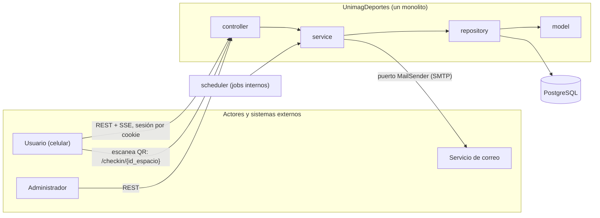
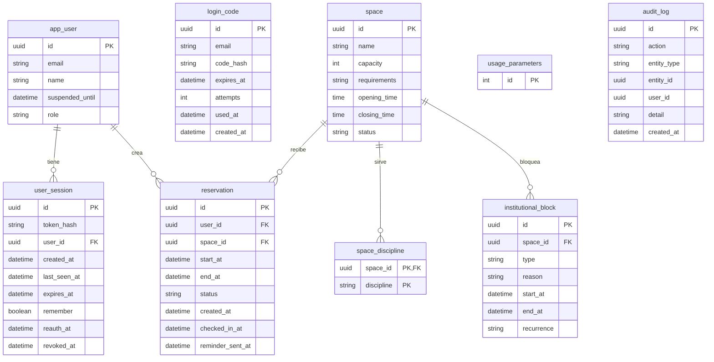
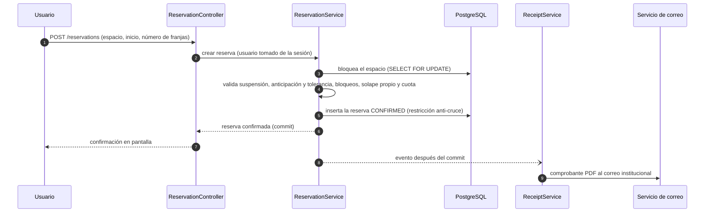
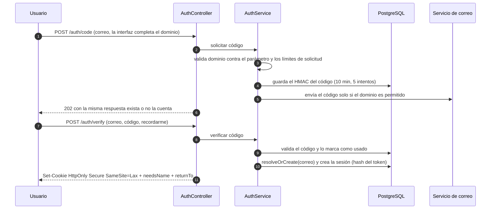
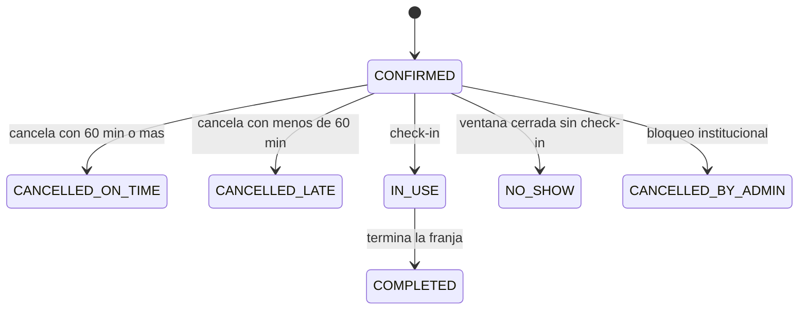

# Implementation Plan: UnimagDeportes — Plataforma de reserva de canchas

**Date**: 2026-10-13
**Última revisión**: 2026-10-14 (estrategia de login y sesión, UC01)
**Spec**: `docs/features/001-…` a `docs/features/012-…` (UC01–UC12). **Fuente funcional**: `docs/reglas-y-contexto/unimagDeportes.md`. Si un SPEC y el contexto discrepan, se consulta antes de decidir.
**Alcance de este documento**: solo la estructura general. Clases concretas, SQL exacto y contratos detallados van en `docs/features/<NNN>-<nombre>/plan.md` (ver §11).
**Leyenda**: **[CONTEXTO]** respaldado por `unimagDeportes.md` o los SPEC · **[TÉC]** propuesta técnica por confirmar · **OQ-xx** punto abierto (§10) · **H1/H2** historia de usuario 1 o 2 dentro de un SPEC.

---

## Summary

UnimagDeportes es una aplicación web para reservar canchas de la universidad (baloncesto, voleibol, fútbol 5, fútbol 11 y tenis de campo) con disponibilidad en tiempo real, confirmación automática y reglas de uso aplicadas sin intervención del administrador. No hay cobros: el único control es la cuota semanal.

Se construye como **un monolito (un solo despliegue) con arquitectura de n capas**: `controller → service → repository → model`, con **PostgreSQL**. No hay colas de mensajería ni microservicios; el único sistema externo es el **servicio de correo**.

El acceso se hace con un **código de un solo uso enviado al correo institucional** y una sesión larga (30 días). Es un prototipo 100 % funcional pensado para ser **sustituido por el inicio de sesión de Microsoft** de la universidad sin tocar los casos de uso de negocio (§7.1, D-08, D-09).

---

## Technical Context

**Language/Version**: Java (LTS vigente) **[TÉC, OQ-01]**. El `pom.xml` actual usa Java 25.
**Primary Dependencies**: Spring Boot (estable vigente; el `pom.xml` actual usa 4.1.1): Web MVC (en Boot 4, `spring-boot-starter-webmvc`), Validation, Data JPA, Security (sesión propia por cookie, sin Spring Session), Mail, Scheduling, Actuator, Flyway **[TÉC, OQ-01]**. Librería de PDF a elegir en el plan de UC11.
**Storage**: PostgreSQL (`timestamptz`; extensión `btree_gist` para impedir cruces)
**Testing**: JUnit 5, AssertJ, Mockito, Testcontainers (PostgreSQL), servidor de correo de prueba (por ejemplo GreenMail). En desarrollo local, Mailpit para ver los correos reales que genera la aplicación.
**Target Platform**: Contenedores Docker; Docker Compose en desarrollo (PostgreSQL y Mailpit)
**Project Type**: Backend monolítico (API REST + SSE). El cliente web *mobile-first* lo consume y debe servirse **en el mismo sitio que la API** (mismo dominio, idealmente el mismo origen mediante un proxy) por la cookie de sesión `SameSite` (OQ-01, OQ-13).
**Constraints** **[CONTEXTO]**: cero cruces con verificación y bloqueo transaccional (RN-10); parámetros configurables, no fijos en el código (sección 4); fechas en America/Bogota (RNF-07); solo nombre y correo del usuario (RNF-09); auditoría de reservas, cancelaciones, check-ins y sanciones (RNF-08); reservar en 5 pasos o menos y en 40 s (RNF-01, RNF-03); *mobile-first* y WCAG (RNF-02, RNF-05)
**Scale/Scope**: 12 SPECs (UC01–UC12) con 20 historias de usuario; actores Usuario, Administrador, Servicio de correo y Sistema. Una sola universidad y volumen bajo: una instancia basta.

---

## 1. Alcance y trazabilidad SPEC → componentes

Cada SPEC agrupa los casos de uso del diagrama que comparten actor, datos y reglas; el contenido de cada caso quedó como una historia de usuario dentro de su SPEC (D-16).

| UC (SPEC) | Historias de usuario | Quién lo invoca | Canal |
|---|---|---|---|
| UC01 Iniciar sesión | H1 Acceder con correo institucional (código de un solo uso) | Usuario, Administrador | REST (cookie de sesión) |
| UC02 Consultar disponibilidad | H1 Calendario en tiempo real | Usuario, Administrador; interno (`include` de UC03) | REST + SSE |
| UC03 Reservar espacio deportivo | H1 Reservar una o dos franjas | Usuario | REST |
| UC04 Gestionar mis reservas | H1 Consultar · H2 Cancelar | Usuario | REST |
| UC05 Confirmar asistencia (QR) | H1 Check-in · H2 Generar e imprimir QR | Usuario · Administrador | REST (enlace del QR) |
| UC06 Reglas de uso | H1 Consultar · H2 Configurar | Usuario · Administrador | REST |
| UC07 Gestionar espacios y franjas | H1 Espacios y horario · H2 Bloquear franjas | Administrador | REST |
| UC08 Consultar cuota semanal | H1 Ver cuota · H2 Reinicio semanal | Usuario · Sistema | REST (H1); derivado (H2, ver D-06) |
| UC09 Consultar panel de administración | H1 Ocupación · H2 Indicadores | Administrador | REST |
| UC10 Aplicar sanciones | H1 Inasistencia · H2 Suspensión | Sistema | Scheduler |
| UC11 Enviar correos al usuario | H1 Comprobante PDF · H2 Notificaciones | Interno (H1 es `include` de UC03) · Sistema | Servicio de correo |
| UC12 Contactar administrador | H1 Enviar mensaje | Usuario | REST |

**Relaciones del diagrama UML respetadas** (`docs/uc-diagrams/Unimag-deportes-uc-diagram`): `include`: UC03→UC02 y UC03→UC11-H1 (comprobante). Los 11 casos del diagrama quedan cubiertos: Iniciar sesión (UC01), Consultar disponibilidad (UC02), Reservar espacio (UC03), Consultar mis reservas y Cancelar reserva (UC04), Confirmar asistencia (UC05-H1), Consultar y Configurar reglas (UC06), Gestionar espacios y Bloquear franjas (UC07), Enviar comprobante (UC11-H1). Provienen del contexto y aún no están en el diagrama: UC05-H2, UC08, UC09, UC10, UC11-H2 y UC12.

---

## 2. Principios rectores

1. **Cero cruces**: un espacio nunca tiene dos reservas activas en la misma franja. La verificación y el bloqueo ocurren en una sola transacción, respaldada por una restricción en la base de datos (RN-10).
2. **Reglas configurables**: los parámetros de la sección 4 viven en la base de datos, nunca en el código.
3. **Las mismas reglas para todos** los Usuarios (RN-02); no hay cobros monetarios (principio 1).
4. **La identidad sale siempre de la sesión**, nunca del cuerpo, la URL ni el QR (RN-03, RN-32).
5. **Datos mínimos del Usuario**: nombre y correo institucional (RNF-09).
6. **Toda fecha y hora en America/Bogota**, con un `Clock` inyectado (RNF-07).
7. **La cuota se deriva de las reservas**, no se almacena (RN-16, RN-17, RN-19).
8. **Un fallo de correo no deshace una operación de negocio** **[TÉC, OQ-04]**. Excepción: el código de acceso. Sin correo no hay ingreso, así que se informa al Usuario y se le deja reintentar.
9. **Los estados de la reserva son los de la sección 6 del contexto** y solo cambian a través de los services.
10. **El mecanismo de autenticación es sustituible**: fuera de `security` y del módulo `auth`, nadie sabe cómo se autenticó la persona. El resto del sistema solo ve un `UserPrincipal(id, email, role)` (D-08, D-09).
11. **La sesión no congela permisos**: el rol y el estado se leen de la base de datos en cada petición, toda sesión se puede revocar desde el servidor y toda sesión tiene un límite absoluto de duración (D-17 a D-19).

---

## 3. Arquitectura

### 3.1 Vista de contexto



### 3.2 Decisión de capas: n capas simples en un solo módulo

| Capa | Paquete | Responsabilidad |
|---|---|---|
| Controller | `controller` | Entrada HTTP (REST y SSE): valida el formato, mapea DTO y exige el rol. Sin lógica de negocio. |
| Service | `service` | Casos de uso y reglas de negocio; define las transacciones. Las reglas puras viven en `service/policy`. |
| Repository | `repository` | Acceso a datos (Spring Data JPA; consultas nativas donde haga falta). |
| Model | `model` | Entidades JPA y enumeraciones. |

Paquetes transversales: `dto`, `security`, `mail`, `scheduler`, `exception`, `config`.

Dentro de cada capa los archivos se agrupan por **módulo de negocio** (`auth`, `space`, `reservation`, `block`, `parameter`, `notification`, `report`). Los módulos se hablan **solo mediante sus services**, de modo que si algún día hay que separar uno, la frontera ya existe.

| Concepto compartido | SPEC que lo tocan |
|---|---|
| `Reservation` (estado, horario, check-in) | UC03 la crea; UC04 la lista (H1) y la cancela (H2); UC05-H1 registra el check-in; UC07-H2 la cancela por bloqueo; UC10 la marca inasistencia o completada; UC08, UC09 y UC02 la leen |
| `UsageParameters` | UC06-H2 la escribe; UC01, UC03, UC04, UC05, UC06-H1, UC08, UC10 y UC11 la leen |
| `Space` (y sus franjas derivadas) | UC07-H1 lo escribe; UC02, UC03, UC05-H2 (QR) y UC09 lo leen |
| `InstitutionalBlock` | UC07-H2 lo crea; UC02, UC03 y UC09 lo leen |
| `AppUser` (incluye suspensión) | UC01 lo crea; UC10-H2 lo suspende; UC03 valida su estado |
| `UserSession` | UC01 la crea, la renueva y la revoca; el filtro de `security` la lee en cada petición |
| `MailSender` (correo saliente) | UC01 (código de acceso), UC11 (comprobante y notificaciones) y UC12 |

### 3.3 Estructura del proyecto

```text
unimag-deportes/
├── docs/
│   ├── technical-plan/general-plan.md          # Este documento
│   ├── reglas-y-contexto/unimagDeportes.md
│   ├── uc-diagrams/
│   └── features/NNN-<uc>/{spec.md, plan.md}
├── src/main/java/com/unimag/deportes/          # paquete raíz por confirmar (OQ-01)
│   ├── UnimagDeportesApplication.java
│   ├── controller/       # auth, availability, reservation, checkin, space, block, parameter, quota, report, contact
│   ├── service/          # un service por tema
│   │   └── policy/       # QuotaPolicy, CancellationPolicy, CheckInWindowPolicy, BookingWindowPolicy, WeekCalculator,
│   │                     # SessionPolicy, LoginCodePolicy
│   ├── repository/       # un repositorio por entidad
│   ├── model/            # AppUser, LoginCode, UserSession, Space, Reservation, InstitutionalBlock,
│   │                     # UsageParameters, AuditLog + enums (ReservationStatus, Discipline, BlockType, Role)
│   ├── dto/              # request/response (las entidades no se exponen)
│   ├── security/         # SessionAuthenticationFilter, UserPrincipal, SecurityConfig, control de roles y de
│   │                     # reautenticación, límite de solicitudes y de intentos de código
│   ├── mail/             # MailSender (puerto), SmtpMailSender, plantillas, ReceiptPdfGenerator
│   ├── scheduler/        # ReservationLifecycleJob, ReminderJob, AuthCleanupJob
│   ├── exception/        # BusinessException y derivadas + GlobalExceptionHandler
│   └── config/           # Spring, Clock (America/Bogota), seguridad, SSE
├── src/main/resources/{application.properties, db/migration/V*.sql}
├── src/test/java/…       # espejo de paquetes
├── Dockerfile
├── compose.yaml          # PostgreSQL y Mailpit (desarrollo)
└── pom.xml
```

### 3.4 Reglas de dependencia

1. `controller` solo invoca `service` y usa `dto`; nunca `repository` ni `model`.
2. `service` usa `repository`, `model` y otros `service`. **No usa el repository de otro módulo**: pide al service de ese módulo.
3. `repository` solo conoce `model`.
4. Las entidades JPA no salen del service: los controllers reciben y devuelven DTO.
5. `service/policy` es **puro** (sin Spring ni JPA): recibe valores y devuelve decisiones, y se prueba con pruebas unitarias.
6. Controller, filtro de seguridad y scheduler son puntos de entrada: todos llaman a services.
7. Ningún componente lee la hora del sistema: todos usan el `Clock` inyectado.
8. Opcional: verificar las reglas 1 a 4 y la 9 con ArchUnit en las pruebas.
9. **Aislamiento de la autenticación**: solo `security` y los services del módulo `auth` (`AuthService`, `LoginCodeService`, `SessionService`, `UserService`) conocen cómo se autenticó la persona. Los demás controllers y services reciben un `UserPrincipal` y nunca tocan códigos, tokens ni cookies.

### 3.5 Mapa SPEC → componentes (semilla de los planes específicos)

| UC | Controller / entrada | Services principales | Persistencia | Invariantes clave |
|---|---|---|---|---|
| UC01 | `AuthController` (incluye `/me`) | `AuthService`, `LoginCodeService`, `SessionService`, `UserService` (`resolveOrCreate(email, name)`) | `app_user`, `login_code`, `user_session`, `audit_log` | Dominio institucional (parámetro) validado en el servidor sobre el correo completo; código de 6 dígitos guardado como HMAC, de un solo uso, con 10 min de vigencia y 5 intentos; límites de solicitud por correo y por IP, y misma respuesta exista o no la cuenta; el nombre se pide solo en el primer ingreso (sin nombre solo se permiten `/me` y `/auth/*`); el Usuario suspendido puede iniciar sesión (RN-05); sesión en cookie `HttpOnly`/`Secure`/`SameSite=Lax` con límite de inactividad y límite absoluto, revocable; `returnTo` solo acepta rutas internas; reautenticación del Administrador en acciones sensibles. Detalle en §7.1 |
| UC02 | `AvailabilityController` | `AvailabilityService` | lectura de `space`, `reservation`, `institutional_block` | Franja libre, ocupada o bloqueada; el espacio compartido se ocupa completo (RN-07); mantenimiento no reservable (RN-09); franja iniciada reservable hasta fin de tolerancia (RN-27, RN-28); motivo visible en bloqueos (RN-44); cambios por SSE; consulta sin sesión: OQ-14 |
| UC03 | `ReservationController` | `ReservationService`, `QuotaService` | `reservation` | Una transacción: bloquear espacio → validar → insertar; 1 o 2 franjas consecutivas; hasta 7 días; sin solape propio (RN-11); cuota (4 h por defecto, configurable); no suspendido; comprobante después del commit (UC11-H1) |
| UC04 | `ReservationController` | H1 `ReservationQueryService` · H2 `CancellationService`, `CancellationPolicy` | `reservation` | H1: solo las reservas del Usuario de la sesión, todos los estados, acción de cancelar. H2: vista previa con efecto en la cuota (RN-25); 60 min o más = a tiempo, menos = tardía (umbral configurable); no se cancela con check-in (RN-24); notifica (RN-26); no hay cancelación manual del Administrador |
| UC05 | `CheckInController` · `SpaceController` (QR, admin) | H1 `CheckInService`, `CheckInWindowPolicy` · H2 `QrService` | `reservation` (H1); H2 se deriva del id del espacio | H1: el Usuario de la sesión debe ser el dueño de la reserva en ese espacio (RN-33); sin sesión, el cliente lleva al login y vuelve a `/checkin/{id_espacio}` (RN-34); ventana desde 10 min antes hasta fin de tolerancia; reservas hechas en tolerancia: 10 min desde su creación (RN-30); motivo de rechazo visible (RN-35). H2: QR estático con enlace fijo `/checkin/{id_espacio}`, sin datos del Usuario (RN-31, RN-32); imprimible |
| UC06 | `ParameterController` (H1 público, H2 admin) | `ParameterService` | `usage_parameters` | H1: lenguaje claro, valores vigentes, sin números fijos en el código. H2: solo Administrador **con reautenticación reciente**; edita los parámetros de la sección 4 (sin cobros); efecto sobre reservas existentes: OQ-05 |
| UC07 | `SpaceController` (H1, admin) · `BlockController` (H2, admin) | H1 `SpaceService` · H2 `BlockService` | `space`, `space_discipline`, `institutional_block`, `reservation` | H1: atributos de RN-06; franjas de 60 min derivadas del horario de operación (RN-08); mantenimiento no reservable. H2: exige reautenticación reciente (cancela reservas en masa); prioridad sobre reservas libres (RN-42); cancela las afectadas con estado `CANCELLED_BY_ADMIN`, no cuentan cuota y avisa con motivo (RN-43); bloquea el espacio durante la operación |
| UC08 | `QuotaController` | `QuotaService`, `WeekCalculator` | lectura de `reservation` | H1: horas usadas = reservas que cuentan en la semana (lunes 00:00 America/Bogota); disponibles = cuota − usadas; fecha de reinicio = próximo lunes. H2: sin job; la cuota se calcula sobre la semana de la fecha de la franja (RN-17) |
| UC09 | `ReportController` (admin) | H1 `OccupancyService` · H2 `IndicatorService` | consultas sobre `reservation`, `institutional_block`, `space`, `app_user` | Solo lectura; H1 con filtros por fecha, disciplina y espacio; H2: reservas, cancelaciones tardías, inasistencias y suspendidos, período: OQ-08 |
| UC10 | `ReservationLifecycleJob` | `SanctionService` | `reservation`, `app_user` | Sin check-in al cerrar la ventana → `NO_SHOW` con horas contadas; 3 en 30 días → suspende 7 días; reservas futuras se mantienen (RN-37 a RN-40); conteo tras suspensión: OQ-07 |
| UC11 | llamadas internas · `ReminderJob` | H1 `ReceiptService` · H2 `NotificationService` + `MailSender` | `reservation.reminder_sent_at` | H1: PDF con espacio, fecha, hora, nombre, reglas de cancelación y canal de contacto (RN-45, RN-48), al correo del Usuario. H2: recordatorio 2 h antes con enlace para cancelar (RN-46); cancelación, bloqueo, inasistencia y suspensión (RN-47); todos con canal de contacto (RN-48); falla de entrega: OQ-04 |
| UC12 | `ContactController` | `ContactService` + `MailSender` | — | Envía el mensaje al correo del área de deportes; sin persistir (OQ-10) |

---

## 4.1 Modelo de datos (PostgreSQL)

Convenciones: UUID como identificadores, `timestamptz` para instantes (se interpretan en America/Bogota), enums como texto, migraciones versionadas con Flyway. **No hay tabla de franjas ni de cuota**: ambas se derivan (D-06).

| Tabla | Propósito / columnas relevantes | Restricciones |
|---|---|---|
| `app_user` | `id`, `email`, `name` (vacío hasta el primer ingreso), `suspended_until`, `role` **[TÉC, OQ-02]**, `created_at` | `UNIQUE(email)` guardado en minúsculas y sin espacios; solo nombre y correo como datos personales (RNF-09) |
| `login_code` | `id`, `email`, `code_hash` (HMAC con clave del servidor), `expires_at`, `attempts`, `used_at`, `created_at` | Un solo uso; al pedir un código nuevo se invalidan los anteriores del correo; las solicitudes por correo se cuentan con `created_at`; `AuthCleanupJob` borra los vencidos |
| `user_session` | `id`, `token_hash` (SHA-256 de un token aleatorio de 256 bits), `user_id`, `created_at`, `last_seen_at`, `expires_at` (límite absoluto), `remember`, `reauth_at` (nulo si no ha reautenticado), `revoked_at` (nulo si está vigente) | `UNIQUE(token_hash)`; `FOREIGN KEY` a `app_user`; índice por `user_id` (para revocar todas las sesiones de una persona) |
| `space` | `id`, `name`, `capacity`, `requirements`, `opening_time`, `closing_time` **[TÉC, OQ-06]**, `status` (`ACTIVE`, `MAINTENANCE`) | RN-06 |
| `space_discipline` | `space_id`, `discipline` (baloncesto, voleibol, fútbol 5, fútbol 11, tenis de campo) | `PRIMARY KEY(space_id, discipline)` |
| `reservation` | `id`, `user_id`, `space_id`, `start_at`, `end_at`, `status`, `created_at`, `checked_in_at`, `reminder_sent_at` | `CHECK(end_at > start_at)`; **restricción de exclusión**: mismo `space_id` con rangos que se solapan solo entre estados que no liberan el espacio; **segunda exclusión** equivalente por `user_id` (RN-11) |
| `institutional_block` | `id`, `space_id`, `type` (clases y grupos formativos, eventos o torneos, mantenimiento), `reason`, `start_at`, `end_at`, `recurrence` (nullable, OQ-06) | Índice por `(space_id, start_at)` |
| `usage_parameters` | Singleton (`id = 1`): una columna por cada parámetro de la sección 4 | `CHECK` de rangos; cada guardado sobrescribe |
| `audit_log` | `id`, `action`, `entity_type`, `entity_id`, `user_id` (nullable), `detail`, `created_at` | RNF-08; sin códigos ni tokens en `detail`. Además de reservas, cancelaciones, check-ins y sanciones, registra `LOGIN`, `LOGIN_FAILED`, `LOGOUT` y `LOGOUT_ALL` **[TÉC]** |

**Estados de la reserva que no liberan el espacio** (participan en la restricción de exclusión): `CONFIRMED`, `IN_USE`, `COMPLETED`, `NO_SHOW`. Las tres cancelaciones liberan.

**Por qué dos mecanismos para no cruzar** (D-04, D-05): la restricción de exclusión impide dos reservas solapadas en la tabla `reservation`. Como los bloqueos viven en otra tabla, además se bloquea la fila del espacio durante las operaciones de reservar y bloquear.

### 4.2 Diagrama Entidad-Relación



`login_code` no se relaciona por clave foránea con `app_user`: el código se pide antes de que la cuenta exista (la cuenta se crea al verificar el primer código).

---

## 5. Conexiones y procesos internos

### 5.1 Matriz de conexiones

| # | Origen → Destino | UC | Estilo | Transporte |
|---|---|---|---|---|
| C1 | Usuario o Administrador → sistema | UC01 a UC09, UC12 | Request/response | REST con cookie de sesión |
| C2 | Usuario o Administrador → sistema | UC02 | Actualización en vivo | SSE |
| C3 | Usuario → sistema | UC05-H1 | Enlace fijo del QR | `/checkin/{id_espacio}` (ruta del cliente) que llama al endpoint de check-in; sin sesión, el cliente lleva al login con `returnTo` y regresa |
| C4 | Sistema → Servicio de correo | UC01, UC11, UC12 | Envío | SMTP mediante el puerto `MailSender` |
| C5 | Sistema → sistema | UC10, UC11-H2, limpieza de UC01 | Eventos por tiempo | Scheduler |

El sistema **no usa colas de mensajería**: los correos se envían después del commit mediante un evento interno. El código de acceso es la excepción: se envía dentro de la solicitud, porque el Usuario espera el correo para continuar y debe saber si falló.

### 5.2 Jobs internos programados

| Job | Origen | Regla |
|---|---|---|
| `ReservationLifecycleJob` (cada minuto) | UC10 y sección 6 del contexto | (a) Reservas `CONFIRMED` sin check-in cuya ventana cerró pasan a `NO_SHOW`, se evalúa la suspensión y se notifica. (b) Reservas `IN_USE` cuya franja terminó pasan a `COMPLETED`. |
| `ReminderJob` (cada minuto) | UC11-H2 | Reservas `CONFIRMED` que empiezan en 2 horas o menos y con `reminder_sent_at IS NULL`: envía el recordatorio y marca la fecha. |
| `AuthCleanupJob` (cada hora) | UC01 | Borra códigos de acceso vencidos o usados y sesiones vencidas o revocadas hace más de 7 días **[TÉC]**. |

Los tres jobs son idempotentes (se apoyan en el estado y en `reminder_sent_at`). **El reinicio semanal (UC08-H2) no tiene job**: ver D-06. Con una sola instancia no hace falta bloqueo de jobs; si algún día se despliegan varias, habrá que agregarlo.

### 5.3 Calendario en vivo

`GET /spaces/{id}/availability/stream` (SSE) avisa al cliente cuando cambia la disponibilidad del espacio (reserva, cancelación, bloqueo, cambio de estado). El cliente vuelve a pedir el calendario. Alternativa si el SSE complica el despliegue: *polling* corto (D-11).

### 5.4 Flujo de referencia: reservar → comprobante



### 5.5 Flujo de referencia: iniciar sesión con código



Si la persona escaneó un QR sin sesión (RN-34), el cliente guarda `/checkin/{id_espacio}` como `returnTo`, hace este flujo en la misma pestaña y vuelve al check-in.

---

## 6. Contratos (índice de endpoints) **[TÉC]**

Este índice solo fija las rutas y los roles. El detalle de cada contrato (solicitud, respuesta y errores) se escribe en el `plan.md` de cada SPEC.

| Método y ruta | UC | Rol |
|---|---|---|
| `POST /auth/code` | UC01 | Público (con límite de solicitudes) |
| `POST /auth/verify` | UC01 | Público (con límite de intentos) |
| `GET /me` | UC01 | Autenticado |
| `PUT /me/profile` (nombre en el primer ingreso) | UC01 | Autenticado |
| `POST /auth/logout` | UC01 | Autenticado |
| `POST /auth/logout-all` | UC01 | Autenticado |
| `POST /auth/reauth/code`, `POST /auth/reauth/verify` | UC01 | Administrador |
| `GET /spaces?discipline=` | UC02, UC03 | Usuario, Administrador |
| `GET /spaces/{id}/availability?date=` | UC02 | Usuario, Administrador |
| `GET /spaces/{id}/availability/stream` (SSE) | UC02 | Usuario, Administrador |
| `POST /reservations` | UC03 | Usuario |
| `GET /reservations/mine` | UC04-H1 | Usuario |
| `GET /reservations/{id}/cancellation-preview` | UC04-H2 | Usuario |
| `POST /reservations/{id}/cancellation` | UC04-H2 | Usuario |
| `POST /checkin/{spaceId}` | UC05-H1 | Usuario |
| `GET /admin/spaces/{id}/qr` | UC05-H2 | Administrador |
| `GET /rules` | UC06-H1 | Usuario |
| `GET /admin/parameters`, `PUT /admin/parameters` | UC06-H2 | Administrador (el `PUT` exige reautenticación reciente) |
| `GET/POST/PUT /admin/spaces` | UC07-H1 | Administrador |
| `POST /admin/blocks` | UC07-H2 | Administrador (exige reautenticación reciente) |
| `GET /quota/me` | UC08-H1 | Usuario |
| `GET /admin/occupancy` | UC09-H1 | Administrador |
| `GET /admin/indicators` | UC09-H2 | Administrador |
| `POST /contact` | UC12 | Usuario |

Sin endpoint propio: UC08-H2, UC10 y UC11 (internos).

Con Microsoft (§7.1.5), `/auth/code`, `/auth/verify` y `/auth/reauth/*` se reemplazan por el flujo OAuth (`/oauth2/authorization/microsoft` y su retorno). `/me`, `/auth/logout`, `/auth/logout-all` y todos los endpoints de negocio no cambian.

---

## 7. Aspectos transversales

### 7.1 Seguridad

#### 7.1.1 Login por código al correo institucional **[TÉC, OQ-03]**

**Flujo**
1. El Usuario escribe solo su usuario (`jperez`) y la interfaz completa el dominio. **El servidor valida el correo completo** (un solo `@`, dominio exacto contra el parámetro de UC06-H2) y no confía en lo que hizo la interfaz.
2. Si el dominio es permitido, se genera un código de 6 dígitos con un generador seguro, se guarda su HMAC y se envía por correo. Si no lo es, se rechaza y no se envía nada. La respuesta es la misma haya o no cuenta previa.
3. El Usuario escribe el código (campo con `autocomplete="one-time-code"` para que el celular lo sugiera). Se valida que esté vigente, sin usar y con menos de 5 intentos, y se marca como usado.
4. `UserService.resolveOrCreate(email, name)` ubica o crea el `app_user`; `SessionService` crea la sesión y entrega la cookie. El cliente vuelve a `returnTo`.

**Por qué código y no enlace mágico**: el flujo del QR (RN-34) empieza en el celular, y el enlace de un correo suele abrirse en otro navegador o en un WebView, donde se pierden la sesión y el destino. Con código, todo ocurre en la misma pestaña.

**Primer ingreso**: el código no trae el nombre y el comprobante lo necesita (RN-45). Se pide una sola vez (`PUT /me/profile`); mientras falte, el filtro solo deja pasar `/me` y `/auth/*`, y los demás endpoints responden `403 PROFILE_INCOMPLETE`. Con Microsoft el nombre vendrá en el token y este paso desaparece.

| Regla del código | Valor inicial **[TÉC]** |
|---|---|
| Formato | 6 dígitos, generador criptográficamente seguro |
| Almacenamiento | HMAC con clave del servidor (un hash simple de 6 dígitos se rompe por fuerza bruta si la tabla se filtra) |
| Vigencia | 10 minutos |
| Uso | Un solo uso; pedir uno nuevo invalida los anteriores del correo |
| Intentos de verificación | 5 por código |
| Solicitudes | 3 por correo cada 10 minutos, y un límite por IP para impedir que se use la plataforma para llenar buzones ajenos |
| Respuesta | Idéntica exista o no la cuenta; el rechazo por dominio sí es explícito (el dominio no es secreto) |
| Correo enviado | Solo a dominios permitidos; el texto indica que el código no se comparte con nadie |

Con 3 códigos y 5 intentos por ventana de 10 minutos, un atacante tiene 15 intentos sobre 1.000.000 de combinaciones: cerca de 0,0015 % por ventana. El bloqueo temporal tras fallos acumulados se define en el plan de UC01.

#### 7.1.2 Sesión

**Mecanismo.** Al verificar el código, el servidor genera un token aleatorio de 256 bits y lo entrega en una cookie. En la base de datos solo se guarda su SHA-256 (`user_session.token_hash`). La cookie no lleva datos del usuario, rol ni fechas: es una llave sin significado fuera de la base de datos. En cada petición, el filtro calcula el hash de la cookie, busca la fila y reconstruye quién es la persona. Cada login genera un token nuevo; nunca se acepta uno anterior (evita la fijación de sesión).

**Cookie**: `HttpOnly`, `Secure` (salvo el perfil `dev` en localhost), `SameSite=Lax`, y en producción el prefijo `__Host-` (obliga `Secure`, `Path=/` y sin `Domain`). Con `Lax` el flujo del QR funciona: escanear abre `/checkin/{id}` como navegación de nivel superior y la cookie viaja.

**Dos límites explícitos.** La inactividad se mide en el servidor con `last_seen_at`; el máximo absoluto, con `expires_at`. Un deslizamiento sin tope sería un riesgo: una cookie robada y usada con frecuencia nunca expiraría.

| Perfil | Inactividad | Máximo absoluto | Cookie |
|---|---|---|---|
| Usuario con "Recordarme en este dispositivo" (marcada por defecto, *mobile-first*) | 14 días | 30 días | Persistente |
| Usuario sin "Recordarme" (equipo compartido) | 2 horas | 12 horas | De sesión (muere al cerrar el navegador) |
| Administrador | 4 horas | 12 horas | De sesión, sin opción de recordar |

Todos los valores son iniciales **[TÉC]** y se calibran. `last_seen_at` se actualiza como máximo cada 5 minutos para no escribir en cada petición. El usuario promedio reserva pocas veces por semana, por lo que en la práctica se identifica una vez al mes.

**Cierre y revocación.** `POST /auth/logout` marca `revoked_at` en la sesión actual; `POST /auth/logout-all` lo hace en todas las sesiones de esa persona (equipo perdido o robado). Una sola sentencia `UPDATE ... WHERE user_id = ?` revoca todo; es la ventaja de tener la sesión en el servidor.

**Reautenticación del Administrador.** Las acciones que cancelan reservas en masa o cambian las reglas (`POST /admin/blocks`, `PUT /admin/parameters`) exigen `reauth_at` dentro de los últimos 10 minutos. Si no lo hay, responden `403 REAUTH_REQUIRED` y el cliente pide un código nuevo (`/auth/reauth/*`).

#### 7.1.3 Amenazas y mitigaciones

| Amenaza | Mitigación |
|---|---|
| Robo de la cookie por XSS | `HttpOnly`, escapar la salida, CSP estricta |
| Robo en la red | HTTPS obligatorio, HSTS, `Secure` |
| CSRF | `SameSite=Lax` más token CSRF de Spring Security en todo `POST`/`PUT`/`DELETE`, incluidos los de `/auth` |
| Fijación de sesión | Token nuevo en cada login; nunca se acepta uno previo |
| Fuga de la base de datos | Solo se guardan el hash del token y el HMAC del código: quien lea las tablas no puede suplantar a nadie ni adivinar códigos |
| Fuerza bruta del código | 5 intentos, 10 minutos, 3 solicitudes por ventana (§7.1.1) |
| Llenar buzones ajenos con códigos | Límite por correo y por IP; no se envía a dominios no permitidos |
| Enumeración de cuentas | Misma respuesta exista o no la cuenta |
| Redirección abierta (`returnTo`) | Solo se aceptan rutas internas que empiezan con `/` (no `//`); el cliente valida contra sus rutas conocidas |
| Inyección en cabeceras del correo | El correo se valida estrictamente y nunca se arma una cabecera con texto crudo del cliente |
| Equipo perdido o compartido | Cierre de sesión, cierre de todas las sesiones, sesión de equipo compartido corta |
| Cookie robada y usada siempre | Límite absoluto de 30 días (12 h para el Administrador) y revocación |
| Phishing del código | No se evita con OTP: el correo advierte que no se comparte. Microsoft con MFA lo reduce (§7.1.7) |
| Correo del Usuario comprometido | Quien controla el buzón controla la cuenta, igual que con SSO; se mitiga con revocación y límites de tiempo |

#### 7.1.4 Autorización: la sesión no congela los permisos

- `SessionAuthenticationFilter` llama a `SessionService.authenticate(token)`, que hace **una sola consulta** (`user_session` unida a `app_user`) y verifica con `SessionPolicy` (pura) que la sesión no esté revocada, vencida ni inactiva.
- El `UserPrincipal(id, email, role)` se arma con los datos **actuales** de `app_user`, no con lo que había al iniciar sesión. Si el rol cambia, el efecto es inmediato.
- Un Usuario suspendido conserva su sesión y puede consultar (RN-05); lo que se rechaza es crear reservas, y eso lo valida UC03 contra la base de datos (RN-38, RN-40).
- Los roles se verifican **en el servidor**; ocultar un botón no cuenta como control.

#### 7.1.5 Ruta de migración a Microsoft (Entra ID)

| Elemento | Hoy (código por correo) | Con Microsoft |
|---|---|---|
| Verificación de la persona | `LoginCodeService` y `/auth/code`, `/auth/verify` | `oauth2Login()` de Spring Security con Entra ID |
| Provisionar el usuario | `UserService.resolveOrCreate` | La misma |
| Creación de la sesión | `SessionService` | La misma, llamada desde el *success handler* de OAuth |
| Autorización, roles, suspensión | Igual | Igual |
| Cambio en endpoints de negocio | — | Ninguno |
| Tablas | `app_user`, `login_code`, `user_session` | Se agrega `external_identity(user_id, provider, subject)` con `UNIQUE(provider, subject)` y se elimina `login_code` |

Notas para la migración:
- El primer ingreso con Microsoft enlaza por correo al `app_user` existente y guarda el `oid`. Desde ahí se identifica por `oid`, porque los correos pueden cambiar.
- Entra no siempre entrega el claim `email`: puede hacer falta `preferred_username` o `upn`. Conviene validar el `tid` del tenant.
- Guardar el `oid` es un dato adicional frente a RNF-09 (solo nombre y correo). Es un identificador técnico, pero debe quedar documentado.
- **Iniciar ya el registro de la aplicación en Entra ID** con TI de la universidad (consentimiento de administrador, URI de redirección). Suele ser lo más lento (OQ-15).
- Sesión y autorización se conservan, por eso la migración no toca UC02 a UC12.

#### 7.1.6 Perfil `dev` y pruebas de seguridad

- **Perfil `dev`**: login directo por correo, sin código, para avanzar en los demás casos de uso sin depender del correo. Existe solo con `@Profile("dev")`; una prueba verifica que el contexto sin ese perfil no expone `/dev/**`.
- **Mailpit** en `compose.yaml` para ver los correos localmente. Para pruebas reales hace falta un proveedor SMTP con SPF y DKIM: los correos desde cuentas personales hacia `@unimagdalena.edu.co` suelen caer en spam.
- **Pruebas mínimas de UC01**: código inválido, vencido, reutilizado y con 5 intentos; límites de solicitud; dominio no permitido sin envío; misma respuesta exista o no la cuenta; sesión vencida por inactividad y por límite absoluto; sesión revocada; token nuevo en cada login; cambio de rol efectivo en la siguiente petición; `returnTo` externo rechazado; CSRF; `REAUTH_REQUIRED` en acciones sensibles.

#### 7.1.7 Limitaciones aceptadas del prototipo

- **Depende del correo**: si el envío falla, cae en spam o tarda, nadie entra.
- **Se puede engañar al Usuario para que entregue su código**; Microsoft con MFA es más robusto.
- **Un correo comprometido compromete la cuenta**, y los 30 días alargan la exposición.
- **Fricción en cada login**: hay que salir de la app a leer el correo. Ocurre una vez al mes.
- **Parte del trabajo es desechable**: `LoginCodeService`, `login_code` y los endpoints `/auth/code`, `/auth/verify` y `/auth/reauth/*` desaparecen con Microsoft.
- **Más trabajo que un login simulado**: Spring Security, filtro de sesión, correo y tablas nuevas.

#### 7.1.8 Generales

- El `user_id` de cada reserva, check-in o cancelación sale de la sesión, nunca de la petición (RN-03, RN-33).
- HTTPS en todo; base de datos sin acceso desde internet; credenciales (incluida la clave del HMAC) en variables de entorno o gestor de secretos, nunca en el repositorio.
- Ningún registro (log o auditoría) contiene códigos de acceso ni tokens.
- Aviso de tratamiento de datos personales (Ley 1581 de 2012); revisar con la universidad si el proyecto se oficializa.

### 7.2 Resiliencia (valores iniciales **[TÉC]** a calibrar)

| Dependencia | Timeout | Reintentos | Comportamiento ante fallo |
|---|---|---|---|
| Servicio de correo (SMTP) | 10 s | 2 con *backoff* | Se registra el fallo; **no se revierte** la reserva, cancelación ni sanción (comportamiento definitivo: OQ-04). Si falla el código de acceso, se informa al Usuario y puede pedir otro |
| Jobs programados | — | Se reintentan en la siguiente ejecución | Idempotentes; un fallo no deja estados a medias |
| Reservas concurrentes | — | — | Gana la primera; la segunda recibe "La franja ya no está disponible" con el calendario actualizado (RN-10) |

### 7.3 Observabilidad
Actuator (`/health`), logs con `reservation_id` y `user_id`. Métricas mínimas: fallos de envío de correo, ejecuciones de jobs y reservas por estado. De autenticación: códigos enviados y fallidos, verificaciones fallidas (un pico indica abuso) y sesiones activas.

### 7.4 Configuración **[TÉC]**
En `application.properties` (por entorno): zona horaria `America/Bogota`, datos del servidor de correo y los parámetros de seguridad de acceso de la tabla siguiente. Los parámetros de negocio de la sección 4 **no** van aquí: viven en `usage_parameters` y los edita el Administrador (UC06-H2). Los de seguridad se dejan fuera de `usage_parameters` a propósito (D-20). El dominio de correo permitido sí es un parámetro de negocio y vive en `usage_parameters`.

| Clave (prefijo `app.auth`) | Valor inicial | Nota |
|---|---|---|
| `code.ttl` | 10 minutos | Vigencia del código |
| `code.max-attempts` | 5 | Intentos por código |
| `code.max-requests-per-email` | 3 por 10 minutos | Solicitudes de código |
| `code.max-requests-per-ip` | por calibrar | Solicitudes de código |
| `code.hmac-secret` | variable de entorno | Nunca en el repositorio |
| `session.remember.idle` / `.absolute` | 14 días / 30 días | Usuario con "Recordarme" |
| `session.default.idle` / `.absolute` | 2 horas / 12 horas | Usuario sin "Recordarme" |
| `session.admin.idle` / `.absolute` | 4 horas / 12 horas | Administrador |
| `session.touch-interval` | 5 minutos | Frecuencia de `last_seen_at` |
| `reauth.window` | 10 minutos | Vigencia de la reautenticación |
| `cookie.name` / `cookie.secure` | `__Host-session` / `true` | `secure=false` solo en `dev` |
| `admin-emails` | lista de correos | Siembra del rol Administrador (OQ-02) |

---

## 8. Estados de la reserva



| Estado | Cuenta contra la cuota | Libera el espacio |
|---|---|---|
| `CONFIRMED` | Sí | No |
| `IN_USE` | Sí | No |
| `COMPLETED` | Sí | — |
| `CANCELLED_ON_TIME` | No | Sí |
| `CANCELLED_LATE` | Sí | Sí |
| `NO_SHOW` | Sí | — |
| `CANCELLED_BY_ADMIN` | No | Sí |

Los cambios de estado los hacen solo los services: `CancellationService` (cancelaciones), `CheckInService` (`IN_USE`), `BlockService` (`CANCELLED_BY_ADMIN`) y `SanctionService`/`ReservationLifecycleJob` (`NO_SHOW`, `COMPLETED`).

---

## 9. Decisiones de diseño y justificación

| ID | Decisión | Alternativas descartadas | Justificación | SPEC |
|---|---|---|---|---|
| D-01 | **Un monolito, un solo despliegue** | Microservicios | Dominio pequeño, una sola base de datos y una operación transaccional crítica (cero cruces) | Todos |
| D-02 | **n capas simples** `controller → service → repository → model` | Hexagonal / Clean Architecture; multi-módulo | Proporcional al tamaño del proyecto; menos ceremonia | Todos |
| D-03 | Módulos de negocio como **subpaquetes dentro de cada capa**; se comunican solo por services | Capas sin orden; un módulo Maven por tema | Mantiene la puerta abierta a separar un módulo sin reglas pesadas | Todos |
| D-04 | **Restricciones de exclusión** en PostgreSQL (espacio + rango y usuario + rango) | Validar solo en el código | Garantiza RN-10 y RN-11 aun con solicitudes simultáneas | UC03 |
| D-05 | **Bloqueo de la fila del espacio** al reservar y al bloquear | Nivel de aislamiento serializable global | La restricción no cubre la tabla de bloqueos; se serializa solo lo necesario | UC03, UC07 |
| D-06 | **Cuota y reinicio derivados** de las reservas, sin tabla de saldo ni job | Tabla de contador semanal con job de reinicio | RN-17: la semana es la de la franja; no hay saldo que desincronizar y el reinicio semanal (UC08-H2) se cumple sin tarea programada | UC03, UC08 |
| D-07 | Jobs `@Scheduled` en el mismo proceso, idempotentes | Broker de mensajes | Un solo sistema, sin infraestructura adicional | UC10, UC11 |
| D-08 | **Login por código de un solo uso al correo institucional**, con sesión larga en base de datos. Microsoft (Entra ID) es el destino final | Contraseña local; Microsoft desde el inicio; enlace mágico; login simulado | Una contraseña propia obliga a registro, verificación y recuperación, y luego hay que descartarla. El código demuestra que la persona controla un buzón del dominio (RN-01), reduce la fricción (RNF-01, RNF-03), se parece al flujo de Microsoft y funciona con el QR en la misma pestaña (RN-34). El login simulado solo existe en el perfil `dev` | UC01 |
| D-09 | Autenticación aislada en el módulo `auth` y `security`; el resto ve un `UserPrincipal`; reservas ligadas a `app_user.id`; `resolveOrCreate` como punto único de aprovisionamiento | Acoplar reservas o controllers al mecanismo de login | Migrar a Microsoft cambia cómo se verifica la persona y no toca los casos de uso de negocio (§7.1.5) | UC01 |
| D-10 | Comprobante y avisos por **evento posterior al commit** + `MailSender` como puerto | Enviar dentro de la transacción | Un fallo de correo no deshace la reserva; se prueba con un servidor falso | UC11 |
| D-11 | Calendario en vivo con **SSE** | *Polling*; WebSocket | RNF-04 con poco código; el *polling* corto es la alternativa si complica | UC02 |
| D-12 | Parámetros en la tabla singleton `usage_parameters` | `application.properties`; tabla clave-valor | El Administrador los edita sin redespliegue (UC06-H2) | UC06 |
| D-13 | **DTO** propios; las entidades JPA no salen del service | Exponer entidades | La API no se acopla al modelo de datos | Todos |
| D-14 | `Clock` inyectado con America/Bogota y `timestamptz` | Hora del servidor; `LocalDateTime` | RNF-07; tolerancia y ventanas se prueban sin depender del reloj real | Todos |
| D-15 | Código en **inglés**, documentación en español (tabla §12) | Todo en español | Coherente con el proyecto anterior **[TÉC, OQ-01]** | Todos |
| D-16 | **12 SPECs con historias de usuario**: los casos que comparten actor, datos y reglas son historias de una misma SPEC | Una SPEC por cada caso del diagrama (19) | Menos archivos y menos contenido repetido; el diagrama sigue siendo la referencia de los casos | Todos |
| D-17 | **Sesión propia en `user_session`** con token opaco de 256 bits y solo su hash en la base de datos | Spring Session JDBC (guarda el ID de sesión sin cifrar); JWT de 30 días (no revocable) | Una fuga de la base de datos no permite suplantar. La revocación es una fila, y los límites de inactividad y absoluto son columnas. Cuesta un filtro propio, que ya está previsto en `security` | UC01 |
| D-18 | **Dos límites de sesión**: inactividad y máximo absoluto, con perfiles Usuario con "Recordarme", Usuario sin "Recordarme" y Administrador | Deslizamiento sin tope; una sola duración para todos | Con 30 días absolutos una cookie robada no vive para siempre; el Administrador, con más privilegios, tiene sesión corta | UC01 |
| D-19 | **Rol y estado leídos de la base de datos en cada petición** | Guardar el rol en la sesión o en un JWT | Un cambio de rol o una revocación surten efecto de inmediato, sin esperar a que la sesión expire | UC01, UC03 |
| D-20 | **Parámetros de seguridad en `application.properties`**, no en `usage_parameters` | Hacerlos editables por el Administrador | Quien configura las reglas de uso no debería poder debilitar la seguridad, y no son parámetros de la sección 4 | UC01, UC06 |
| D-21 | **Reautenticación con código nuevo** para las acciones sensibles del Administrador | Confiar en la sesión de 12 horas | Los bloqueos cancelan reservas en masa (UC07-H2) y las reglas afectan a todos (UC06-H2); una sesión abierta no basta | UC01, UC06, UC07 |

---

## 10. Puntos abiertos (OQ)

| ID | Punto | Afecta | Propuesta por defecto |
|---|---|---|---|
| OQ-01 | Stack, versiones, paquete raíz (el repositorio ya usa `unimagdeportes`, Java 25 y Spring Boot 4.1.1), idioma de los identificadores y tecnología del cliente web | Todo | Java + Spring Boot + PostgreSQL; cliente web que consume la API, en el mismo sitio (OQ-13) |
| OQ-02 | Cómo se identifica a un Administrador (el contexto no lo define) | UC01, UC05-H2, UC06-H2, UC07, UC09 | Columna `role` en `app_user`; el rol se siembra desde una lista de correos de administradores (`app.auth.admin-emails`) que `resolveOrCreate` aplica. Con Microsoft podría pasar a un grupo de Entra |
| OQ-03 | El login por código no está en el contexto ni en el diagrama (RF-01 y RN-01 no definen el método). Decidido para el prototipo (D-08); falta reflejarlo en `unimagDeportes.md` y reescribir la SPEC 001 | UC01 | Mantener el login por código y documentarlo como sustituible por Microsoft |
| OQ-04 | Comportamiento si falla el envío de correo (comprobante, avisos, código de acceso) | UC01, UC11 | Registrar el fallo y no revertir la operación; en el código de acceso, informar y permitir reintentar |
| OQ-05 | Efecto de cambiar parámetros o de poner un espacio en mantenimiento sobre reservas existentes; y diferencia entre el estado "en mantenimiento" del espacio y el bloqueo institucional de tipo mantenimiento | UC06-H2, UC07 | Rige para operaciones nuevas |
| OQ-06 | Estructura del horario de operación y de la recurrencia de los bloqueos | UC07 | `opening_time`/`closing_time` simples; recurrencia a definir |
| OQ-07 | Conteo de inasistencias después de una suspensión | UC10 | — |
| OQ-08 | Período de los indicadores | UC09-H2 | — |
| OQ-09 | Horizonte del calendario frente al límite de 7 días para reservar | UC02 | — |
| OQ-10 | Si el canal de contacto de RN-48 es el formulario de UC12 | UC11, UC12 | — |
| OQ-11 | Dominio exacto de correo (el contexto dice "confirmar") | UC01, UC06 | `@unimagdalena.edu.co` como parámetro |
| OQ-12 | Contradicciones del contexto: RN-16 y el Escenario A usan 3 h; la tabla de parámetros usa 4 h (se tomó 4 h). "Desactivar" espacios (RF-11) frente a los estados "activo"/"en mantenimiento" (RN-06) | UC03, UC06, UC07, UC08 | 4 h; tratar "desactivar" como pasar a mantenimiento hasta confirmar |
| OQ-13 | Arquitectura del cliente: la cookie `SameSite=Lax` exige que cliente y API estén en el mismo sitio. Con un front en otro dominio, o con una app móvil, habría que usar CORS con credenciales o cambiar a token de acceso corto con *refresh* | UC01, D-17 | Mismo sitio (mismo dominio, idealmente mismo origen con un proxy) y cookie de sesión |
| OQ-14 | Dejar ver el calendario sin sesión: reduce fricción, pero UC02 hoy asume usuario autenticado | UC02 | No: se mantiene UC02 como está |
| OQ-15 | Registro de la aplicación en Entra ID: consentimiento de administrador, URI de redirección, tenant y claims disponibles (`email`, `preferred_username`, `upn`, `tid`, `oid`). Guardar `oid` toca RNF-09 | UC01 | Iniciar el trámite con TI en paralelo; mientras tanto rige el login por código |

---

## 11. Dependencias y orden de ejecución

### Dependencias entre fases
- **Setup (1)** → sin dependencias. Incluye `compose.yaml` con PostgreSQL y Mailpit. **Foundational (2)** → depende de 1 y **bloquea** todo lo demás.
- **Foundational (2)** se construye en este orden: `MailSender` base → UC01 (código, sesión, filtro, `/me`, reautenticación) → parámetros base → auditoría. El perfil `dev` permite avanzar en las fases siguientes sin depender del correo real.
- **UC06 y UC07-H1 (3)** → dependen de 2 (parámetros y espacios son insumo de todo lo que sigue). UC05-H2 (QR) se agrega aquí porque solo necesita los espacios.
- **UC02 (4)** → depende de 3. **UC03, UC11-H1, UC08 y UC04-H1 (5)** → dependen de 4 (UC03 incluye UC02) y de 3.
- **UC04-H2 y UC05-H1 (6)** → dependen de 5 (el check-in también de UC05-H2).
- **UC07-H2, UC10 y UC11-H2 (7)** → UC07-H2 depende de 5; UC10 de 6; UC11-H2 se construye de forma **incremental**: el servicio base y `MailSender` en la fase 2, y cada plantilla (recordatorio, cancelación, bloqueo, inasistencia, suspensión) junto al caso de uso que la dispara.
- **UC12 y UC09 (8)** → pueden iniciar después de 5 y completarse al final. **Polish (N)** → después de las fases deseadas.
- **En paralelo desde la fase 1**: el trámite de Entra ID con TI (OQ-15), porque es lo más lento y no depende del código.

```text
1 Setup → 2 Foundational (UC01 login OTP + parámetros base + correo base + auditoría)
        → 3 UC06 + UC07-H1 + UC05-H2 → 4 UC02 → 5 UC03/UC11-H1/UC08/UC04-H1 → 6 UC04-H2/UC05-H1
                                                          │
                                                          └──► 7 UC07-H2/UC10/UC11-H2 ──► 8 UC12/UC09 ──► N Polish
```

### Qué debe contener cada plan específico por SPEC (`docs/features/NNN-…/plan.md`)
1. Resumen y trazabilidad a los RF, RNF y CE del SPEC (indicando a qué historia pertenece cada uno).
2. Clases concretas (controller, service, policy, repository, model) con rutas reales.
3. Migración SQL exacta.
4. Contrato REST del caso de uso (solicitud, respuesta y errores).
5. Reglas de negocio con ejemplos numéricos (con la cuota de 4 h) y manejo de errores por escenario.
6. Estrategia de pruebas con una prueba por cada criterio de éxito (`CE-xxx`). El plan de UC01 incluye además las pruebas de seguridad de §7.1.6.
7. Tareas granulares con dependencias y los OQ que lo afecten.

---

## 12. Lenguaje ubicuo (contexto → código)

| Término del contexto | Identificador en código |
|---|---|
| Usuario / Administrador | `AppUser` / rol `ADMIN` |
| Persona autenticada en la petición | `UserPrincipal` |
| Código de acceso | `LoginCode` |
| Sesión | `UserSession` |
| Reautenticación | `reauth` (`reauth_at`) |
| Espacio / Disciplina | `Space` / `Discipline` |
| Franja | `Slot` (derivada, no persistida) |
| Reserva | `Reservation` |
| Cuota semanal | `WeeklyQuota` (derivada) |
| Tolerancia | `toleranceMinutes` (parámetro) |
| Check-in | `CheckIn` (`checked_in_at`) |
| Cancelación a tiempo / tardía | `CANCELLED_ON_TIME` / `CANCELLED_LATE` |
| Inasistencia | `NO_SHOW` |
| Bloqueo institucional | `InstitutionalBlock` |
| Parámetros de uso | `UsageParameters` |
| Comprobante | `Receipt` |
| Servicio de correo | `MailSender` |

---

## Notes

- `[UCxx]` mapea cada tarea a su SPEC; `[UCxx-Hy]` a una historia concreta.
- Cada fase debe poder validarse de forma independiente antes de pasar a la siguiente.
- Resolver los puntos abiertos (OQ) antes de implementar el SPEC al que afectan; hasta entonces rige la propuesta por defecto.
- **La SPEC 001 debe actualizarse** con escenarios del código de acceso (solicitud, código inválido o vencido, límite de intentos), primer ingreso con captura del nombre, cierre de sesión, sesión del Administrador y una nota explícita de que el método es sustituible por OAuth con Microsoft (OQ-03).
- Evitar: tareas vagas, llamadas a repositories de otro módulo y lógica de negocio en controllers.
- Los valores de los ejemplos en los planes específicos son ilustrativos.